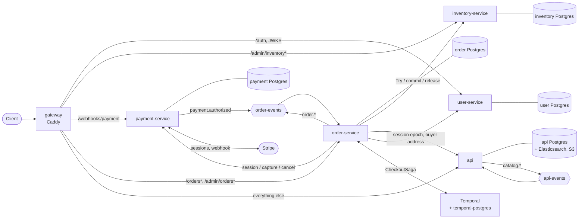

# JCool E-commerce Backend

A single-store e-commerce backend: a NestJS modular monolith plus five services extracted from it, each with its own Postgres. It is built to get the hard parts of commerce right — **never oversell, never double-charge, never lose an event** — and to prove it with tests that kill services mid-checkout.

<p>
  <a href="https://github.com/jCool10/jcool-ecommerce-backend/actions/workflows/ci.yml"></a>
  
  
  
  
  
</p>

**Live:** <https://jcool-ecommerce.up.railway.app> · OpenAPI <https://jcool-ecommerce.up.railway.app/docs>

## What this is

A backend for a **single-store** shop, not a multi-vendor marketplace. It began as one NestJS process split into bounded contexts behind a boundary the build enforces, so that each context could later leave as bounded work rather than a rewrite. Identity, id minting, stock, payment and checkout have since left; Product, Cart and Media remain in the monolith.

Four invariants drive nearly every design decision:

| Invariant | How it holds |
| --- | --- |
| **Never oversell** | Stock is held in the inventory-service's own transaction, fenced per order, with three Postgres `CHECK` constraints as the backstop |
| **Never double-charge** | A client `Idempotency-Key`, a unique index on active payments, webhook dedup, and a manual-capture charge captured once, only after its stock has committed |
| **Money and stock stay consistent with order state** | A Temporal saga is the order's only writer; every step before the capture is compensated (release the stock, void the card hold) until it lands |
| **The order is the transaction source of truth** | Each line snapshots its price and name, so a later reprice cannot move a placed order |

**Not in scope, deliberately:** multi-vendor, automatic refunds, and a deployed tracing collector. Where a guarantee is weaker than it looks, [Known limits](#known-limits) says so.

## Architecture

Five Node services, a Caddy gateway and a self-hosted Temporal server, deployed on Railway. Each service owns its database and shares no table and no foreign key with another. The diagram shows the public domain on the gateway, which is a manual cut-over step ([RUNBOOK](./RUNBOOK.md#put-the-gateway-in-front-of-the-api)).



| Service | Owns |
| --- | --- |
| [api](./apps/api/README.md) | The modular monolith: catalog and search, cart, media uploads |
| [user-service](./apps/user-service/README.md) | `/auth`, sessions, ES256 token signing and the JWKS |
| [inventory-service](./apps/inventory-service/README.md) | Stock levels and the checkout's TCC holds |
| [payment-service](./apps/payment-service/README.md) | Payments, the Stripe integration and its webhook |
| [order-service](./apps/order-service/README.md) | Orders and the checkout saga's Temporal worker |
| [id-service](./apps/id-service/README.md) | 63-bit snowflake ids for every service, three replicas leasing node ids from etcd |
| gateway | Caddy: public routing as drawn, and the private load balancer over the id-service |

Queues are BullMQ on a shared Redis, which also carries session epochs and the token denylist. Internal routes answer `404` from outside, and each one admits named callers by a token of their own. Stripe, S3 and SMTP are the only systems outside the project. Inside each service, Clean Architecture layering is enforced in CI by `pnpm arch:check`. The boundaries, the layering contract and every durable decision with its rejected alternatives: [system-architecture.md](./docs/system-architecture.md).

## Engineering highlights

The parts worth reading the code for. The full write-up, with the file behind each, is [engineering-highlights.md](./docs/engineering-highlights.md).

- **No oversell under contention** — stock is held inside the inventory-service's own transaction, under a row lock or a version CAS picked by config, and fenced per order so a late Try holds nothing. [code](./apps/inventory-service/src/modules/inventory/application/inventory-participant.service.ts) · [test](./apps/order-service/test/integration/checkout-oversell.e2e-spec.ts)
- **Checkout across services** — a Temporal saga with stock and payment as TCC participants. Capture under Stripe manual capture is the pivot: everything before it is undone by a release and a void. [code](./apps/order-service/src/modules/order/domain/checkout-saga.ts) · [test](./apps/order-service/test/integration/checkout-saga-cancel.e2e-spec.ts)
- **Duplicate checkout requests** — an idempotency gate replays the first answer, and a unique index on `(user_id, idempotency_key)` backs it up; a key reused with another body is `422`. [code](./apps/order-service/src/modules/order/interface/idempotency.interceptor.ts)
- **No lost events** — a transactional outbox relayed with `FOR UPDATE SKIP LOCKED`, and an inbox claim committed in the same transaction as the effect: at-least-once delivery, exactly-once effect. [code](./packages/messaging/src/queue/domain-event.processor.ts)
- **Search that follows Postgres** — catalog events reach Elasticsearch through the outbox and land as externally versioned writes, so a stale or reordered delivery is refused. [code](./apps/api/src/modules/product/application/catalog/services/product-search-sync.service.ts) · [decision](./docs/system-architecture.md#search-index-consistency)
- **Thundering herd** — a stale-while-revalidate cache behind a Redis single-flight rebuild lock; with Redis down, lookups in one process share a single Postgres read. [code](./apps/api/src/shared/cache/swr-cache.service.ts)
- **Overload** — the api sheds requests past 48 in flight with `503` and `Retry-After` before Nest runs, and the gateway caps each upstream's connections. [code](./packages/platform/src/resilience/load-shedding.middleware.ts)
- **Immediate token revocation** — stateless ES256 tokens are re-checked per request against a Redis denylist and a per-user epoch; a reused refresh token revokes its whole family. [code](./packages/auth-verifier/src/access-token.verifier.ts)
- **63-bit ids** — `45 ts │ 8 node │ 10 seq` in a Postgres `bigint`, minted by a leased id-service and carried as a string past JSON's 53 bits. [code](./packages/id-codec/src/snowflake.codec.ts)
- **Alerts as code** — burn-rate SLOs and saga alerts with `promtool` tests that pin both firing and clearing, and one trace from the HTTP request through the outbox to the consumer. [rules](./infra/prometheus/rules) · [tests](./infra/prometheus/tests)

## Testing

Every claim above is pinned on real Postgres, Redis, MinIO, Elasticsearch, Temporal and SMTP through Testcontainers, with no database mocks.

| Tier | What it covers | Run |
| --- | --- | --- |
| Unit | Domain rules, state machines, and the failure paths no e2e can stage; hermetic | `pnpm test` |
| Integration | Each app wired to real infrastructure; needs Docker | `pnpm test:e2e` |
| System | Production images on a Docker network; local only | `pnpm turbo run test:system --concurrency=1` |

The tests to open first: [the last unit sells once](./apps/order-service/test/integration/checkout-oversell.e2e-spec.ts), [a cancel racing the card authorization ends one way](./apps/order-service/test/integration/checkout-saga-cancel.e2e-spec.ts), [a saga converges through a Temporal outage](./apps/order-service/test/integration/checkout-saga-temporal.e2e-spec.ts), and the [system test](./apps/order-service/test/system/checkout-fault.system-spec.ts) that kills services mid-saga against a fake Stripe and checks the invariants across the databases.

CI runs `lint:check` → `typecheck` → `arch:check` → `railway:check-flip-vars` → `pnpm audit` → `build` → Prometheus rule tests, beside coverage-floored unit and e2e jobs. Coverage floors and tier rules: [code-standards.md](./docs/code-standards.md#tests).

## Quick start

Needs Node ≥ 22.9, pnpm and Docker. The user-service's `.env` needs a signing key (`JWT_ES256_PRIVATE_KEYS`; the openssl one-liner is in its template).

```bash
pnpm install

# env templates, and the root .env linked into apps/api
cp .env.example .env
for app in user-service id-service inventory-service payment-service order-service; do
  cp apps/$app/.env.example apps/$app/.env
done
pnpm dev:link-env

# infrastructure, then the gateway in front of the host
docker compose up -d postgres redis elasticsearch mailpit minio minio-init temporal id-etcd inventory-postgres payment-postgres order-postgres
docker compose --profile user-service up -d user-postgres
pnpm dev:gateway

# build, lift the id-service's etcd floors, migrate every database, seed the catalog
pnpm build
pnpm --filter @jcool/id-service lease:lift-floors --if-uninitialized
pnpm db:migrate
for app in user-service inventory-service payment-service order-service; do
  pnpm --filter @jcool/$app db:migrate
done
pnpm --filter @jcool/api db:seed

# every service on the host, with rebuild on change
pnpm dev

# in a second terminal, once the api answers: stock for every listed variant
pnpm --filter @jcool/inventory-service db:seed
```

Then open the api on <http://localhost:3000> (Swagger at `/docs`), the gateway on <http://localhost:8080> and Mailpit on <http://localhost:8025>. Every port, how `pnpm dev` rebuilds, the full stack in Compose, the local observability stack and every script: [local-development.md](./docs/local-development.md).

## Measured performance

k6 against the live deployment, from a single client in Vietnam. The round trip dominates: `GET /health/live`, which does no work, already costs about 305 ms. The point is how little the application adds above that floor.

| Route | Median at 1.5 req/s | Median at 50 req/s | p95 at 50 req/s |
| --- | ---: | ---: | ---: |
| `GET /health/live` (the floor) | 310.5 ms | 305.9 ms | 725.2 ms |
| `GET /products` (cached list) | 311.9 ms | 308.4 ms | 737.6 ms |
| `GET /products/:slug` (cached detail) | 310.4 ms | 307.7 ms | 646.3 ms |

A cached catalog read sits within about 1.5 ms of the floor, and a 32× rise in load left every median within about 5 ms. At 150 req/s offered, the deployment served about 81 req/s and shed the rest as `429` with flat latency; that ceiling is not attributed to any one component. Method, caveats and the saturation run: [engineering-highlights.md](./docs/engineering-highlights.md#measured-performance).

## Known limits

Stated plainly, because a reviewer will find them anyway. The reasoning behind each is in [system-architecture.md](./docs/system-architecture.md#known-limits).

- **Every write waits on the id-service.** No service mints ids in process, so a write answers `503` while the id-service is unreachable.
- **Order confirmation mail is at-most-once.** A failed send is counted, not retried, because a retry could send up to eight.
- **Auth mail is sent synchronously, outside the outbox**, so its raw token never lands in Postgres.
- **Checkout needs the api, stock, payment, the id-service and Temporal at once.** Temporal is one self-hosted server; while it is down, checkout and cancel answer `503` and catalog and cart keep serving.
- **The strongest checkout test runs locally only.** The fault-injecting system test needs several GB of RAM, so CI runs the integration tier instead.
- **A password change has a race** between revoking sessions and writing the new hash.
- **Ids have hard ceilings.** The id `CHECK` is a floor, not a type, and 1024 ids per node-millisecond and 254 leasable nodes are real limits.
- **IP throttling counts connections** until the public domain moves onto the gateway.
- **Search trails writes by about 1–2 s** and is not read-your-writes.
- **There is no API version prefix**; changes are additive-only.
- **Traces are local-only**; in production a `traceId` only joins log lines.

## Documentation

| To | Read |
| --- | --- |
| Understand why a boundary or decision is what it is | [system-architecture.md](./docs/system-architecture.md) |
| See the engineering detail behind each highlight | [engineering-highlights.md](./docs/engineering-highlights.md) |
| Run, test and script the system locally | [local-development.md](./docs/local-development.md) |
| Change the code and get the change accepted | [code-standards.md](./docs/code-standards.md) |
| Find where something lives | [codebase-summary.md](./docs/codebase-summary.md) |
| Look up a domain term or business rule | [project-overview-pdr.md](./docs/project-overview-pdr.md) |
| Change how or where it deploys | [deployment-guide.md](./docs/deployment-guide.md) |
| Operate the live system | [RUNBOOK.md](./RUNBOOK.md) |
| Call or configure one service | Its README, linked in the service table above |
| Check a route's exact request and response | `/docs` (Swagger UI) |

What is documented where, and the rules for changing it: [docs/README.md](./docs/README.md).

## License

Private / **UNLICENSED**. All rights reserved.
