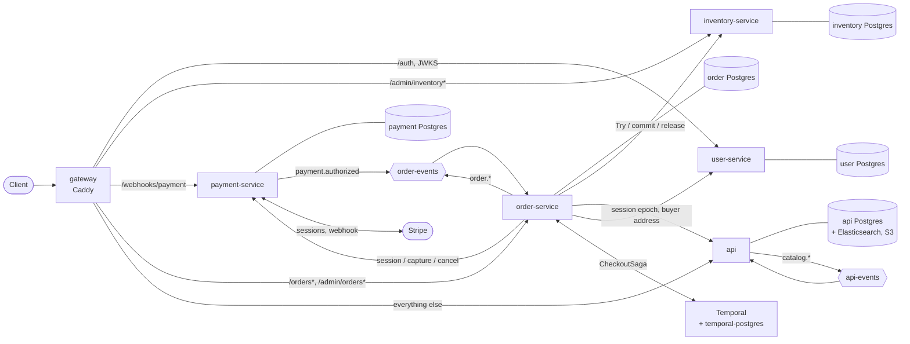
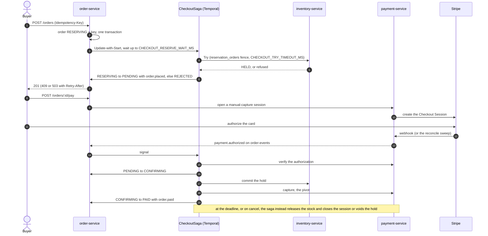

# JCool E-commerce Backend

Single-store e-commerce backend built as a **NestJS modular monolith** and the services extracted from it: identity, ids, stock, payment and checkout each run as a service of their own, with a database of their own, joined by internal HTTP APIs, two Redis queues and a Temporal saga. Clean Architecture layering is enforced by a build gate, with a deliberate focus on the parts of commerce that are hard: **never oversell, never double-charge, never lose an event**.

<p>
  <a href="https://github.com/jCool10/jcool-ecommerce-backend/actions/workflows/ci.yml"></a>
  
  
  
  
  
  
  
  
</p>

**Live:** <https://jcool-ecommerce.up.railway.app> · OpenAPI <https://jcool-ecommerce.up.railway.app/docs>

| | |
| --- | --- |
| **Scale** | api: 3 bounded contexts (Product, Cart, Media), plus the user-service, inventory-service, payment-service, order-service and id-service, a Caddy gateway and a self-hosted Temporal server. Counts of files, tables, migrations and routes are not kept here: `/docs` lists the api's routes and each service's `schema` directory its tables |
| **Tests** | The claims above are pinned on real Postgres, Redis, MinIO, Elasticsearch, Temporal and SMTP (Testcontainers; the id-service suites add etcd), under concurrency and failure: [the last unit sells once](./apps/order-service/test/integration/checkout-oversell.e2e-spec.ts), [a cancel racing the card authorization ends one way](./apps/order-service/test/integration/checkout-saga-cancel.e2e-spec.ts), [a saga converges through a Temporal outage](./apps/order-service/test/integration/checkout-saga-temporal.e2e-spec.ts). A [system test](./apps/order-service/test/system/checkout-fault.system-spec.ts) runs every service as its production image against a fake Stripe, kills them mid-saga and checks the invariants across the databases ([Testing](#testing)). Unit tests cover domain rules, state machines and the failure paths no e2e can stage |
| **Gates** | `lint:check` → `typecheck` → `arch:check` (8 boundary rules) → `railway:check-flip-vars` → `pnpm audit` → `build` → Prometheus rule tests → coverage-floored unit + e2e |

---

## Contents

- [What this is](#what-this-is) · [Architecture](#architecture) · [Engineering highlights](#engineering-highlights)
- [Quick start](#quick-start) · [Configuration](#configuration) · [API](#api)
- [Testing](#testing) · [Measured performance](#measured-performance) · [Observability](#observability)
- [Operations](#operations) · [Known limits](#known-limits) · [Scripts](#scripts)

Changing the code: [`docs/code-standards.md`](./docs/code-standards.md). Running the deployed system: [`RUNBOOK.md`](./RUNBOOK.md). What is documented where: [`docs/`](./docs/README.md).

---

## What this is

A backend for a **single-store** (not multi-vendor) shop. It began as one deployable process split into bounded contexts with boundaries a build step enforces, so that a context could be extracted as a bounded piece of work rather than a rewrite, and every context but Product, Cart and Media has been.

Four invariants drive nearly every design decision in the repository:

| Invariant | How it is held |
| --- | --- |
| **Never oversell** | The checkout saga's Try holds stock in a local transaction of the inventory-service, which owns it, under a row lock or a version CAS, fenced per order by a `reservation_orders` header, with three Postgres `CHECK` constraints as the data-layer backstop. The order lives in another database, so no transaction spans the two: the saga orders the steps and compensates |
| **Never double-charge** | One purchase intent ⇒ one payment: a client `Idempotency-Key`, a partial-unique index on active payments in the payment-service's database, webhook dedup on `(provider, event_id)`, and a manual-capture charge captured once, idempotently, only after its stock has committed |
| **Money and stock stay consistent with order state** | The order is the source of truth and the checkout saga its only writer. Every step before the capture that fails is compensated (release the stock, void the card hold), and compensations retry without limit until they land. The capture is the pivot: after it the order is `PAID` |
| **The order is the transaction source of truth** | Order snapshots each line's price and name; the cart never does — a later reprice cannot move a placed order |

**Not in scope, deliberately:** multi-vendor, automatic refunds, and a deployed tracing collector. Where a guarantee is weaker than it looks, [Known limits](#known-limits) says so.

---

## Architecture

Five Node services, a Caddy gateway and a self-hosted Temporal server on Railway. The api is the modular monolith (Product, Cart, Media); the user-service, the inventory-service, the payment-service, the order-service and the id-service were extracted from it. Each owns a database of its own and shares no table and no foreign key with another. Shown is the routing with the public domain on the gateway; moving it there is a manual step ([RUNBOOK](./RUNBOOK.md#put-the-gateway-in-front-of-the-api)), and the order routes are served only through it.



Every service mints its row ids through the id-service (three replicas behind the gateway's private `:4000` listener, which lease node ids from etcd), and the queues are BullMQ on the shared Redis, which also carries the user-service's session epochs and denylist. Stripe, S3 and SMTP are the only systems outside the project.

The api verifies the user-service's ES256 tokens against its JWKS and reads session epochs from the shared Redis, asking the user-service's internal routes only on a miss; it holds no user rows, no signing key and no `/auth` route. The inventory-service owns stock, and the payment-service owns payments and the Stripe integration; the order-service owns orders and the checkout saga, which holds, commits and releases stock and opens, captures and voids payments over their `/internal/v1` routes. The gateway answers any `/internal/*` path with `404`, so those routes are reachable only on the private network, where each callee admits each caller by a token of its own. Elasticsearch is private too, and the api reaches it as a user limited to `products*`. Why the shape is what it is, and when to revisit it: [system-architecture.md](./docs/system-architecture.md).

### Bounded contexts

| Context | Owns | Lives in |
| --- | --- | --- |
| **Product** | The catalog: categories, products, SKUs, prices, product images, search index. Publishes `PRODUCT_SKU_QUERY` (live price/name). Stock lives in the inventory-service | api |
| **Cart** | Per-user cart lines, quantities only, no prices. Publishes `CART_SNAPSHOT` (`{skuId, quantity}`) | api |
| **Media** | Upload lifecycle, presigned URLs to the object bucket, reclaim sweep. Publishes `MEDIA_FACADE` (Product reads it through its own `MEDIA_QUERY` adapter) | api |
| **Order** | The order aggregate, its state machine, checkout and the checkout saga, which orchestrates stock and payment | order-service |

The order-service reads the api's cart lines and SKU views through its internal routes (`/internal/v1/carts/:userId/lines`, `/internal/v1/catalog/sku-views`), so its adapters over the Cart and Product contexts are HTTP clients rather than in-process ports. No context reads another's tables. Cross-context calls go through an anti-corruption adapter the *calling* context owns, bound to the target's published port or internal API, and there are no cross-context foreign keys anywhere in the schema, which is what kept each extraction from becoming a schema migration.

### Layering

Dependencies point inward; infrastructure is plugged in through ports declared by the inner layers.

<picture>
  <source media="(prefers-color-scheme: dark)" srcset="./docs/diagrams/layering-dark.svg">
  
</picture>

`pnpm arch:check` (dependency-cruiser, 8 error-severity rules) fails the build when `domain` imports a framework or a driver, when `application` imports `infrastructure` or `interface`, when one context reaches into another for anything but its `application/public` surface — internal use cases included, which is the crossing a boundary rule usually forgets — when runtime code loads the shared contract cases, which are test code, when `shared/` imports a context, when one package reaches into another by relative path instead of its published name, or when `domain`/`application` import **any** telemetry package or reach messaging other than through its pure port. That telemetry rule is mechanical because the leak is easy: the observability barrel transitively pulls `@opentelemetry/api`, so one stray import would put a tracing dependency in a domain entity. ESLint adds file-scoped fences of its own: no `await` on the id generator's mint path (the node lease, which talks to etcd, is exempt outside `generate`/`fenced`), and no `uuid`/`randomUUID` where rows are inserted outside the id port — the user-service's infrastructure and id-generator service, and both apps' `scripts/`.

Two composition roots are exempt from the "shared may not import a context" rule, because wiring contexts together is precisely their job: `shared/messaging` (registers context event handlers) and the schema barrel (collects every context's tables for the migrator).

### Project layout

pnpm workspace, tasks run through Turborepo. The main app is `apps/api` (`@jcool/api`): catalog, cart and media. `apps/id-service` mints 63-bit integer ids under a leased node id ([id-service README](./apps/id-service/README.md)). `apps/user-service` owns `/auth` and the user tables in its own Postgres, mints its ids through the id-service and signs ES256 tokens ([user-service README](./apps/user-service/README.md)). `apps/inventory-service` owns stock and the checkout's holds in its own Postgres ([inventory-service README](./apps/inventory-service/README.md)). `apps/payment-service` owns payments, the Stripe integration and the webhook in its own Postgres ([payment-service README](./apps/payment-service/README.md)). `apps/order-service` owns orders and checkout idempotency in its own Postgres and runs the checkout saga's Temporal worker ([order-service README](./apps/order-service/README.md)). `apps/gateway` is Caddy: the public entry that routes `/auth` to the user-service, `/admin/inventory*` to the inventory-service, `/webhooks/payment` to the payment-service, `/orders*` and `/admin/orders*` to the order-service and everything else to the api, and the private load balancer in front of the id-service replicas. `packages/` holds the code the services share.

```
apps/api/
├── src/
│   ├── main.ts              # bootstrap: helmet, CORS, ValidationPipe, Swagger, shutdown hooks
│   ├── instrumentation.ts   # OTel + Sentry, preloaded via `node --import` before Nest boots
│   ├── app.module.ts
│   ├── modules/             # bounded contexts — each: domain / application / infrastructure / interface
│   │   ├── cart/  media/  product/   # product: <layer>/catalog/
│   └── shared/
│       ├── config/          # the api's env schema (platform fragments + its own keys) + config factory
│       ├── messaging/       # the api's route table, queue handlers and DLQ replay CLI over @jcool/messaging
│       ├── infrastructure/  # Drizzle schema + migrations, the api's DrizzleDB alias, object storage
│       ├── cache/           # stale-while-revalidate cache + single-flight rebuild lock
│       ├── identity/        # ID_GENERATOR port + module: every row id comes from the id-service
│       ├── idempotency/     # request fingerprint + CLS carrier
│       ├── interface/       # debug controller
│       └── testing/         # unit-test doubles (id generator, Redis)
├── test/
│   ├── integration/         # e2e suites on real infrastructure (Testcontainers)
│   ├── setup/               # global setup, app factory, fixtures, per-suite side containers
│   ├── mocks/               # deterministic uuid double for the unit tier
│   └── vitest-e2e.config.mts
└── scripts/                 # perf-seed (catalog + cart for the load tests), trace harness
apps/id-service/             # POST /v1/ids; node lease (etcd), N replicas; unit / e2e / system tests
apps/user-service/           # /auth, JWKS, internal user/epoch routes (own Postgres); users scripts; unit / e2e tests
apps/inventory-service/      # stock levels, TCC holds and the per-order fence (own Postgres); /internal/v1/reservations, /admin/inventory; stock seed
apps/payment-service/        # payments, the per-order fence, Stripe and the webhook (own Postgres); /internal/v1/payments, /webhooks/payment; publishes payment.authorized
apps/order-service/          # orders, checkout idempotency, the CheckoutSaga workflow and worker (own Postgres); /orders, /admin/orders; consumes order-events; unit / e2e / system tests
apps/gateway/                # Caddyfile: public site routing /auth, /admin/inventory, /webhooks/payment and the order paths, private LB over the id-service replicas
packages/
├── kernel/                  # @jcool/kernel — framework-free DDD building blocks (Money, ValueObject, DomainError, Result)
├── id-codec/                # @jcool/id-codec — 63-bit snowflake layout
├── id-generator/            # @jcool/id-generator — monotonic snowflake generator, node lease, node ids
├── auth-verifier/           # @jcool/auth-verifier — the access-token check every service runs: ES256, then denylist and session epoch;
│                            #   /session-state: the Redis readers and the user-service client behind them
├── internal-contracts/      # @jcool/internal-contracts — paths, bodies and outcomes of the internal APIs, the order-events queue contract and the payment.authorized event; /testing: the shared contract cases
├── messaging/               # @jcool/messaging — outbox, relay, BullMQ queue, inbox, DLQ replay and the route table type, wired by each service's own routes
├── metrics-port/            # @jcool/metrics-port — the metrics seam domain and application code depend on
├── platform/                # @jcool/platform — Nest infrastructure: env fragments, pg + Drizzle, Redis, observability, metrics,
│                            #   error tracking, health, throttler, rbac, mail, resilience, retention, identity, interface, internal-api;
│                            #   one subpath export each
└── testing/                 # @jcool/testing — test doubles, source-only, dev dependency only
test/load/  k6/              # k6 mixes
infra/                       # Prometheus rules + promtool tests, Grafana dashboard, OTel Collector; Railway images for Prometheus, Loki, Grafana, Elasticsearch, etcd, Temporal
scripts/                     # repo tooling: CI's Railway flip-variable check, rollout wait, perf capture, OpenAPI and doc diagram tooling
docs/                        # standards, architecture decisions, deployment
.railway/railway.ts          # Railway deploy config (infrastructure as code)
turbo.json  pnpm-workspace.yaml  Dockerfile  docker-compose.yml  .github/workflows/  RUNBOOK.md
```

Packages compile to CommonJS `dist/` with `tsc` and are consumed the way production consumes them, tests included. Every Turborepo task depends on `^build`, so the packages are built first, in dependency order: `kernel`, `metrics-port` and `internal-contracts`, then `id-codec`, then `id-generator`, then `platform`, then `auth-verifier` and `messaging`, then the apps. `@jcool/testing` is never built. `pnpm dev` rebuilds a package when it changes and restarts the apps that use it (see [Quick start](#quick-start)). Scripts forwarded straight to the api (`start:dev`, `test:watch`, `db:*`, the CLIs) skip Turborepo and read the last build, so run `pnpm build` after changing a package before using them. Nest, nestjs-pino, prom-client, ioredis and drizzle-orm are among the peer dependencies of `platform`. The lockfile resolves each to a single install shared by the app and the package, and `apps/api/src/platform-peer-dependencies.spec.ts` fails once the two manifests drift apart.

---

## Engineering highlights

The parts worth reading the code for. Each row names the file to open.

### Concurrency and consistency

| Problem | Approach | Where |
| --- | --- | --- |
| **Oversell under contention** | Two interchangeable strategies behind one port, picked by the inventory-service's `INVENTORY_LOCK_STRATEGY`: pessimistic `SELECT … FOR UPDATE`, or a version CAS with bounded retry (`INVENTORY_OPTIMISTIC_MAX_RETRIES`, default 3). Both run inside the participant's Try, a local transaction fenced per order by a `reservation_orders` header, so a duplicate Try holds once and a Try arriving after its release holds nothing, which is what makes a Try that timed out on the wire safe to give up on. Three `CHECK` constraints (`ck_stock_on_hand_nonneg`, `ck_stock_reserved_nonneg`, `ck_stock_no_oversell`) make the database the final authority | `apps/inventory-service/src/modules/inventory/application/inventory-participant.service.ts`, `…/infrastructure/stock.repository.ts` |
| **Checkout across databases** | The order and its stock live in different databases, so checkout is ordered steps, not one transaction. The order-service inserts the order `RESERVING` with its price-snapshot lines and claims the idempotency key under a per-buyer advisory lock, then starts the saga, whose Try holds the stock in the inventory-service's own transaction; the saga then moves the order to `PENDING` and appends `order.placed`, and only then is the key frozen on the `201`. A shortfall leaves the order `REJECTED`, answered `409` and hidden from the buyer, with no key blocking the retry. A Try past its budget answers `503` with `Retry-After`, and its late hold is fenced off | `apps/order-service/src/modules/order/application/use-cases/checkout-order.use-case.ts`, `…/infrastructure/drizzle-order.repository.ts` |
| **Exactly-once settlement** | One workflow per order, the only writer of its status. Each move is a pure transition that lands through `applyOrderChange`: the order row lock plus a from-status guard, so a retried activity is a no-op. No distributed lock. Capture is the pivot: it runs once, idempotently, after stock has committed, and everything before it is undone by release and void | `apps/order-service/src/modules/order/domain/checkout-saga.ts`, `…/infrastructure/drizzle-order.repository.ts` |
| **Duplicate checkout requests** | Two layers: a per-`(scope, key)` idempotency entry gate that replays the first response body and status, and a `UNIQUE (user_id, idempotency_key)` index on `orders` as the backstop. A key reused with a different request body is `422`, not a silent replay. A key left `IN_PROGRESS` by a crashed request is reclaimable after a 30 s lease; a reclaim racing a request that is still alive is safe, because checkout also takes a per-user advisory lock and the unique index still decides | `apps/order-service/src/modules/order/interface/idempotency.interceptor.ts`, `…/application/ports/idempotency-store.port.ts` |
| **Refresh-token theft** | Rotation runs in one `FOR UPDATE` transaction. Presenting a token that was already replaced or revoked revokes the **entire family**, not just that token — and revocation is checked before expiry, so a retired token still reads as reuse rather than as an expiry. Only a replay that finds live tokens counts as theft and bumps the session epoch, so an old token replayed again cannot keep logging the owner out. Rotation holds a shared per-user advisory lock and logout-all / session revoke take it exclusively, so a revoke never misses a successor inserted by a rotation already in flight | `apps/user-service/src/modules/user/infrastructure/drizzle-refresh-token.repository.ts` |

### Distributed systems

Checkout is a saga orchestrated by the order-service as a Temporal workflow (`CheckoutSaga`, id `checkout-<orderId>`), with stock and payment as its two TCC participants. Capture under Stripe manual capture is the pivot: before it, everything is undone by a release and a void; after it, the order is `PAID`. The decision, its rejected alternatives and when to revisit it are in [system-architecture.md](./docs/system-architecture.md#checkout-saga-orchestration-on-temporal-tcc-on-stock-and-payment).



| Anomaly | Countermeasure | Where |
| --- | --- | --- |
| **A Try times out on the wire, then lands** | The Try is one attempt, aborted with its activity. The release that compensates it writes the `reservation_orders` fence first, so the late Try is refused (`FENCED`, answered `CONFLICT`) instead of holding stock nobody will release | `apps/inventory-service/src/modules/inventory/application/inventory-participant.service.ts` |
| **A command is delivered twice, or a worker dies mid-activity** | Commit, release, restock, capture and cancel are idempotent per order, and their activities retry until they land. Temporal replays the workflow after a crash and the order write is guarded by its from-status under the row lock | `apps/order-service/src/modules/order/infrastructure/temporal/workflows/checkout-saga.workflow.ts` |
| **A cancel races the card authorization** | Both are saga inputs handled in order by one workflow, so the order ends one way. A cancel is refused with `409` once payment is being taken | `apps/order-service/test/integration/checkout-saga-cancel.e2e-spec.ts` |
| **The webhook never arrives, or arrives five times** | A polling reconcile sweep asks Stripe about payments whose event never came; `webhook_events` deduplicates on `(provider, event_id)` | `apps/payment-service/src/modules/payment/application/use-cases/reconcile-tcc-payments.use-case.ts` |
| **The card is authorized after the order closed** | A `lateAuthorization` run voids it; an order the database does not hold counts as not `PAID`, so such a run never captures | `apps/order-service/src/modules/order/application/use-cases/forward-payment-authorization.use-case.ts` |
| **Stripe fails or loses a capture answer** | The idempotency key is `capture:{paymentId}:{gen}`, and `gen` moves only after a 5xx that Stripe did not apply, because Stripe replays a stored 5xx for its key | `apps/payment-service/src/modules/payment/infrastructure/schema/payment.schema.ts` |
| **Cleared money on a session no checkout owns** (a card authorized late is voided, never charged, so this is the one refund left) | Logged and counted as a refund owed (`payment_refund_owed_total`); no alert fires on it and refunds are manual ([RUNBOOK → A refund is owed](./RUNBOOK.md#a-refund-is-owed)) | `apps/payment-service/src/modules/payment` |
| **Temporal is down** | `POST /orders` and cancel answer `503` with `Retry-After` and hold no stock; sagas already running converge when it returns. A `RESERVING` order whose start never reached Temporal is handed back by the reaper | `apps/order-service/src/modules/order/application/use-cases/reap-reserving-orders.use-case.ts` |
| **A settled order disagrees with a participant** | An invariant checker compares each settled order with its stock and payment every minute and reports by kind; the system test asserts the same invariants after each injected fault | `apps/order-service/src/modules/order/application/use-cases/run-checkout-invariants.use-case.ts` |

| Problem | Approach | Where |
| --- | --- | --- |
| **The dual-write problem** | Events are rows written by the same transaction as the change they describe. A relay polls `published_at IS NULL` with `FOR UPDATE SKIP LOCKED`, publishes to BullMQ and marks the row published in one transaction — at-least-once, safe on every replica, no leader election. The service that writes the row owns the relay: the api's, the payment-service's and the order-service's each read their own outbox, and the queue each event goes to comes from the service's route table | `packages/messaging/src/outbox/outbox-relay.ts`, `apps/api/src/shared/messaging/event-routes.ts`, `apps/order-service/src/shared/messaging/order-events.routes.ts` |
| **At-least-once → exactly-once** | The consumer claims `message_id = outbox.id` in an `inbox` table (`UNIQUE (consumer, message_id)`) and applies the handler's effect **in that same transaction** (anything slow, such as a call to another service, is prepared before it opens). A redelivery loses the claim and does nothing; a handler that throws takes its claim down with it, so the redelivery does the work | `packages/messaging/src/queue/domain-event.processor.ts` |
| **Sweeping the inbox safely** | Inbox claims are swept on a schedule (`RETENTION_INBOX_DAYS`, default 30d), and the app **refuses to boot** if that retention is shorter than the queue's failed-job horizon — deleting a claim while its message can still be redelivered would apply the effect twice | `packages/messaging/src/inbox/sweep-inbox.ts` |
| **Poison messages** | BullMQ retries with backoff to a bounded attempt budget (`QUEUE_CONSUMER_ATTEMPTS`, default 8 including the first delivery; `order.paid`, which waits on the user-service, gets 15 with a capped backoff, as does `payment.authorized`, which signals the checkout saga and so must outlive a Temporal outage, and `catalog.*`, which waits on the search engine), then routes to the dead-letter queue of the queue it rode: `order-events-dlq` or `api-events-dlq`. Each queue has one consumer service: the order-service for `order-events`, the api for `api-events`, so a burst of catalog events never waits behind order and payment work. `pnpm queue:replay-dlq:order --queue order-events` and `pnpm queue:replay-dlq --queue api-events` interrogate the inbox before re-publishing: a job whose effect already landed is reported `skipped`, and `--force` cannot override that — it only admits a job old enough that its claim may have been swept. Dry run is the default | `packages/messaging/src/queue/dead-letter.replay.ts`, `packages/internal-contracts/src/queues/order-events.ts`, `apps/order-service/src/shared/messaging/order-events.routes.ts` |
| **Search index consistency** | No transaction reaches the engine, so the index follows Postgres through the outbox. Every catalog write bumps `products.search_version` and appends its event in the same transaction; the worker re-reads the product and writes it with `version_type: external`, so the engine refuses a stale, repeated or reordered delivery. An archived product stays as a versioned tombstone, so a late write cannot bring it back. A rebuild fills a fresh index behind a second alias and swaps atomically ([decision record](./docs/system-architecture.md#search-index-consistency)) | `apps/api/src/modules/product/application/catalog/services/product-search-sync.service.ts`, `…/infrastructure/catalog/search/elasticsearch-catalog-search.adapter.ts` |
| **Payment saga convergence** | In the payment-service, two paths record a card hold: the HMAC-verified webhook and the reconcile sweep. Either writes `payment.authorized` once per order to the payment-service's own outbox, whose relay puts it on `order-events`; the order-service's consumer signals the order's workflow, which verifies the authorization with the payment-service before it commits stock. The workflow's own deadline timer expires an order nothing paid, releasing the stock and closing the session, so no sweep over orders is needed | `apps/payment-service/src/messaging/event-routes.ts`, `apps/order-service/src/modules/order/domain/checkout-saga.ts` |
| **A TCC participant across the network** | The saga's Try is one HTTP attempt inside its budget (`CHECKOUT_TRY_TIMEOUT_MS`), aborted with the activity: a lost answer is a `503`, and the release that compensates it fences the late hold. A breaker counts only the service's own faults, never a `409`, a `4xx` or a `503` coded `LOCK_BUDGET_EXHAUSTED`, so neither a sold-out SKU nor a contended one can open it. The payment-service has the same shape: `/pay` makes one attempt and answers `502` when the service fails, and its breaker counts only a `5xx` or no answer. Each internal callee admits each caller by a token of its own, and an allowlist per route says which caller may call it | `apps/order-service/src/modules/order/infrastructure/order-inventory-participant.http-adapter.ts`, `…/order-payment-participant.http-adapter.ts`, `packages/platform/src/internal-api/caller-token.guard.ts` |
| **Trace continuity across the async hop** | The outbox writer captures the W3C `traceparent` at insert, the relay carries it onto the job, and the consumer resumes it, so one trace runs from HTTP request through outbox insert, relay publish and consumer handler | `packages/messaging/src/outbox/drizzle-outbox.writer.ts`, `packages/messaging/src/queue/domain-event.processor.ts`, `packages/platform/src/observability/tracing/propagation.ts` |

### Performance and caching

| Problem | Approach | Where |
| --- | --- | --- |
| **Thundering herd on cache expiry** | Reads go through stale-while-revalidate behind a Redis **single-flight rebuild lock** with a lease and jitter: one request rebuilds, everyone else is served the stale value. `cache_rebuild_duration_seconds` measures the rebuild | `shared/cache/swr-cache.service.ts`, `shared/cache/single-flight.lock.ts` |
| **Catalog-wide invalidation** | A generation counter, not key enumeration: bumping one Redis integer retires every catalog key at once, in O(1). Staleness after a *missed* invalidation is bounded by `CATALOG_CACHE_TTL_SEC` **plus** the shared stale window and jitter (≈100s at defaults) | `modules/product/infrastructure/catalog/catalog-cache.keys.ts`, `modules/product/infrastructure/catalog/caching-catalog-admin.repository.ts` |
| **Cache poisoning across deploys** | The cache codec re-validates every field on read, so a shape change between deploys degrades to a cache refill instead of a 500 | `modules/product/infrastructure/catalog/product-cache.codec.ts` |
| **Presigned URLs vs cached documents** | Catalog stores **asset ids, never URLs**. A presigned URL outlives its cache entry by minutes and the entry by hours, so URLs are resolved *after* the cache read — one batched call per response page. An id whose asset has since gone is dropped rather than rendered as a broken image | `modules/product/application/catalog/use-cases/get-product-detail.use-case.ts` |
| **Unbounded cache keys** | Every query parameter is part of the cache-key fingerprint, so each is bounded at the DTO edge: `page ≤ 10000`, `pageSize ≤ 100`, `categorySlug` must match the slug pattern. An unbounded field would be an unbounded number of cache keys as well as an unbounded query | `modules/product/interface/catalog/dto/list-products-query.dto.ts` |
| **Deep pagination cost** | Count and page are read inside one repeatable-read read-only snapshot with a tie-broken sort, so the total and the rows cannot disagree | `modules/product/infrastructure/catalog/drizzle-product.repository.ts` |

### Security

| Problem | Approach | Where |
| --- | --- | --- |
| **Immediate JWT revocation** | Stateless ES256 access tokens, signed by the user-service and checked against its JWKS, carry `{sub, role, jti, epoch}` and are re-checked per request against a Redis `jti` denylist (one token) and a per-user epoch (every token issued before a logout-all or password change). The user-service is the only writer of those keys; the api only reads them | `packages/auth-verifier/src/access-token.verifier.ts` |
| **Token delivery and CSRF** | The access token goes in the JSON body (Bearer is CSRF-immune). The refresh token goes **only** in an `httpOnly; SameSite=Strict; Path=/auth` cookie, paired with a signed double-submit CSRF cookie enforced on the two routes that consume it. Both live in the user-service; the api takes Bearer only | `apps/user-service/src/modules/user/interface/security/csrf.guard.ts` |
| **Brute force** | Three Redis-backed tiers with different keys: `default` by IP (100/60s app-wide floor; tightened to 20/60s with a 5-min block on the routes that take an email — login, register, resend-verification, forgot-password — and to 30/60s on the other token-consuming auth routes), `account` by IP + SHA-256(email) on those email routes (5/15min, 15min block), `user` by authenticated id on checkout, payment-session creation and cancel (10/60s) — the tier an attacker cannot outrun by rotating IPs | `packages/platform/src/throttler/throttler.constants.ts` |
| **User enumeration** | `forgot-password` and `resend-verification` always answer `202`. Login runs a real argon2 verify against a cached dummy hash on the unknown-email branch, so the timing of "no such user" matches "wrong password" | `apps/user-service/src/modules/user/application/use-cases/login-user.use-case.ts` |
| **Webhook authenticity** | HMAC-SHA256 over the **raw request bytes** (`rawBody: true` — the JSON parser would re-serialize and break the signature), constant-time compare, plus a `±PAYMENT_WEBHOOK_TOLERANCE_SEC` replay window. Never throttled, so a burst of legitimate gateway retries is never rate-limited away. It is the payment-service that verifies it, behind the gateway's `/webhooks/payment` route | `apps/payment-service/src/modules/payment/infrastructure/gateway/hmac-signature.ts` |
| **Metrics endpoint disclosure** | A wrong or missing `METRICS_TOKEN` returns a plain `404`, never `401` — a `401` confirms the endpoint exists to anyone probing. (With no token configured at all, `/metrics` is open in development and `404` in production.) | `packages/platform/src/observability/metrics/metrics.guard.ts` |

### Data modelling

| Problem | Approach | Where |
| --- | --- | --- |
| **One id layout everywhere** | Every id in every service is a signed 63-bit integer in a Postgres `bigint`, laid out `45 ts_ms │ 8 node │ 10 seq` over an epoch of 2026-01-01, good until year 3140. The id carries no routing information: a future shard split would need a lookup or directory, not a bit field, and that is a deliberate trade for the timestamp, node and sequence room the freed bits bought ([decision record](./docs/system-architecture.md#63-bit-snowflake-layout-45-ts_ms--8-node--10-seq)) | `packages/id-codec/src/snowflake.codec.ts` |
| **An integer id that travels as a string** | 63 bits outruns the 53 a JSON number carries exactly, from 2027-02-02 on, so an id crosses the wire as a decimal string and nothing applies `Number()` to one. Drizzle's two `bigint` modes are both wrong here — `number` truncates silently, `bigint` makes `JSON.stringify` throw — so the column is a `customType` whose TypeScript type is `string`. node-postgres already hands back `int8` as a string, so both directions are identity and every `userId: string` signature in the repo stayed as it was | `packages/platform/src/database/snowflake-id.column.ts` |
| **The layout is pinned** | The epoch and field widths are permanent. The user-service's database pins the layout version it was built under and refuses a later boot under a different one, so a layout change is a reset, not a migration ([RUNBOOK → The id layout is permanent](./RUNBOOK.md#the-id-layout-is-permanent)) | `apps/user-service/src/modules/user/infrastructure/identity-layout-pin.verifier.ts` |
| **Money** | Integer minor units (VND đồng, USD cents) in a `Money` value object — never a float. Cross-currency operations throw rather than coerce. The order total is computed once from the lines and then persisted, never recomputed against a live price | `packages/kernel/src/money.vo.ts` |
| **Media lifecycle as stock reservation** | An upload commits to something before knowing whether the caller will finish, so it is modelled like a stock hold: `PENDING → READY → ATTACHED → DETACHED`, plus `SWEEPING` as a terminal claim. `expires_at` is `NULL` in exactly one state (`ATTACHED`) — an asset no sweep can select is exactly what that state needs and exactly the leak every other state must not have | `modules/media/domain/asset-state-machine.ts` |
| **Deleting bytes safely** | The sweep commits its `SWEEPING` claim **first**, then deletes the object, then the row. A crash mid-way leaves an orphan row whose object is gone — re-scannable, and deleting an absent object is a no-op. The other order leaves bytes nobody has a pointer to: unfindable and paid for indefinitely | `modules/media/application/use-cases/sweep-abandoned-assets.use-case.ts` |
| **Deadlock avoidance** | Attaching an image claims the asset and writes the link row in one transaction, always taking `product_images` before `media_assets`, so two concurrent edits of the same asset cannot deadlock | `modules/product/infrastructure/catalog/drizzle-catalog-admin.repository.ts` |

---

## Quick start

**Prerequisites:** Node ≥ 22.9, pnpm (any recent install switches itself to the version pinned in `packageManager`), Docker (for infrastructure and the integration tests).

```bash
# 1. install
pnpm install

# 2. configure — the templates boot as-is against the Compose stack below, once the
#    user-service's .env has a signing key (JWT_ES256_PRIVATE_KEYS; the openssl one-liner is in
#    its template). The api runs from apps/api, so link the root .env there.
cp .env.example .env
cp apps/user-service/.env.example apps/user-service/.env
cp apps/id-service/.env.example apps/id-service/.env
cp apps/inventory-service/.env.example apps/inventory-service/.env
cp apps/payment-service/.env.example apps/payment-service/.env
cp apps/order-service/.env.example apps/order-service/.env
pnpm dev:link-env

# 3. infrastructure (the ports below are the host-mapped ones). The gateway fronts the host:
#    its load balancer on 127.0.0.1:4000, where the apps mint ids, dials the id-service on 3003,
#    and 8080 reaches the api and the four other services as in production.
docker compose up -d postgres redis elasticsearch mailpit minio minio-init temporal id-etcd inventory-postgres payment-postgres order-postgres
docker compose --profile user-service up -d user-postgres
pnpm dev:gateway

# 4. build, schema + catalog (every service but the api migrates from its own build).
#    A fresh etcd has no floors, and the id-service claims no node until it has them.
pnpm build
pnpm --filter @jcool/id-service lease:lift-floors --if-uninitialized
pnpm db:migrate
pnpm --filter @jcool/user-service db:migrate
pnpm --filter @jcool/inventory-service db:migrate
pnpm --filter @jcool/payment-service db:migrate
pnpm --filter @jcool/order-service db:migrate
pnpm --filter @jcool/api db:seed

# 5. run the api, the user-service, the inventory-service, the payment-service, the order-service and the id-service on the host
pnpm dev

# 6. in a second terminal, once the api answers: stock for every listed variant. The seed walks the
#    public catalog through the gateway (CATALOG_PUBLIC_URL), so it cannot run before step 5.
pnpm --filter @jcool/inventory-service db:seed
```

- API → <http://localhost:3000> · OpenAPI → <http://localhost:3000/docs> · user-service → <http://localhost:3002> · id-service → <http://localhost:3003> · inventory-service → <http://localhost:3004> · payment-service → <http://localhost:3005> · order-service → <http://localhost:3006> · gateway → <http://localhost:8080>
- Mail inbox (Mailpit) → <http://localhost:8025> · MinIO console → <http://localhost:9001>
- Postgres → `localhost:5433` (user-service: `localhost:5434`, inventory-service: `localhost:5435`, payment-service: `localhost:5436`, order-service: `localhost:5437`) · Redis → `localhost:6380` · Elasticsearch → `localhost:9200` · id-service load balancer → `localhost:4000` · Temporal → `localhost:7233` (UI on `localhost:8233` with `--profile observability`)
- Without Temporal the api still boots and serves everything but checkout and cancel, which the order-service answers `503`; its `/health/ready` reports `503` naming `temporal` and its saga worker logs `checkout saga worker unavailable; retrying with backoff` until the server answers.

`pnpm dev` is `turbo watch dev`. It builds the packages, then runs `dev` in the api (`nest start --watch`), the user-service, the inventory-service, the payment-service, the order-service and the id-service. A change under `packages/` rebuilds that package and every package that depends on it, then restarts the apps that use them. A change in the api's `src/` is left to Nest's own incremental reload, because [`apps/api/turbo.json`](./apps/api/turbo.json) limits the inputs of the api's `dev` task to its config files (`futureFlags.watchUsingTaskInputs` in the root `turbo.json`). The other services have no watcher of their own, so turbo rebuilds them with `tsc` and restarts them; the id-service releases its node on each restart and claims another. To run one app with the packages it uses: `pnpm turbo watch dev --filter=@jcool/api`. With a filter, turbo 2.11.6 still starts `dev` in the other apps that depend on a package you change; without `watchUsingTaskInputs` it honours the filter, but every save in the api then restarts it twice. Keep `SHUTDOWN_GRACE_PERIOD_MS` at `0` locally, since each restart and Ctrl+C waits it out. Turbo runs tasks in strict env mode, so a variable set on the command line (`PORT=3005 pnpm dev`) never reaches the app; put overrides in the `.env` files. Don't run a service's container alongside `pnpm dev`: each binds the same port as its host twin (3002, 3004, 3005, 3006). `pnpm dev:gateway` stops the id-service containers and recreates the gateway with every upstream on `host.docker.internal`, so the gateway answers `502` while `pnpm dev` is down; `docker compose up -d id-service gateway` puts it back in front of the containers.

`minio-init` is a one-shot that creates `STORAGE_BUCKET` and exits; the app waits on it, so a fresh `docker compose up` has a bucket before the first upload. Elasticsearch is only needed with `SEARCH_ENABLED=true`, and on a Linux host it wants `sudo sysctl -w vm.max_map_count=262144` first (Docker Desktop already sets it). Skipping Mailpit does **not** fall back to the log sink — `.env.example` ships `SMTP_URL` uncommented, so sends would fail against a dead relay; comment it out to use the log sink.

Full stack in-network, behind the gateway as on Railway: `docker compose up -d --build`, then <http://localhost:8080>. The app container publishes no port there; the inventory-service, the payment-service, the order-service, their Postgres databases and their one-shot migrators come up with it. The payment-service runs there with `NODE_ENV=production`, so it refuses to boot without a `sk_test_` `STRIPE_SECRET_KEY` and a `STRIPE_SUCCESS_URL` in the root `.env`, which Compose passes through; `/pay` answers `502` until it is up. `pnpm db:seed` from the host then seeds the api's catalog and, through the gateway, the stock (it reads `apps/inventory-service/.env`). Tear down including volumes: `docker compose --profile '*' down -v` (without a profile, `down` leaves the profile-gated services, the user-service's Postgres and its volume included). The user-service is opt-in, since it needs `apps/user-service/.env`: `docker compose --profile user-service up -d --build user-service` serves it on <http://127.0.0.1:3002>, with its Postgres on 127.0.0.1:5434. Redis runs with AOF on, which the api and the user-service both require.

---

## Configuration

Environment is validated **once at startup** and the process refuses to boot on anything invalid — a missing secret is a crash, not a runtime surprise. Validation is as strict as the loaders that read the values afterwards: integers must be plain decimal (`6e4` is refused rather than loaded as `6`), and booleans must be exactly `true` or `false` (`1` is refused rather than loaded as off). `.env.example` is the commented reference for the api's variables (`APP_PUBLIC_URL`, `COOKIE_SECURE` and `DB_QUERY_TIMEOUT_MS` are read but not listed there yet), plus a few Compose-only ones; these are the ones without a default:

| Variable | Notes |
| --- | --- |
| `NODE_ENV` | `development` \| `test` \| `production` |
| `DATABASE_URL` | Postgres connection string |
| `REDIS_URL` | Shared by cache, throttler, denylist and BullMQ |
| `AUTH_JWKS_URL` | The user-service's JWKS — the only key source, so without it every request is refused |
| `JWT_ISSUER`, `JWT_AUDIENCE` | Must match what the user-service signs |
| `USER_SERVICE_INTERNAL_URL`, `INTERNAL_API_TOKEN` | Its internal API: session epochs on a Redis miss. Token min 32 chars |
| `INTERNAL_CALLER_TOKEN_ORDER_SERVICE` | What the order-service sends on the api's `/internal/v1` routes (cart lines, SKU views). The api holds no token for any other caller; min 32 chars, and the order-service's `API_SERVICE_TOKEN` must equal it |
| `ID_SERVICE_URL` | The gateway's internal id-service listener, never a replica. Every row id is minted there, so a write answers 503 without it (`ID_SERVICE_TIMEOUT_MS`, default 2000, covers the gateway's retries) |

Groups worth knowing about, all optional with working defaults: `CATALOG_CACHE_TTL_SEC` and `CACHE_*`, `QUEUE_*`, `RETENTION_*`, `SEARCH_*`, `STORAGE_*` (S3/R2/MinIO; endpoint, bucket and the key pair are all-or-nothing), `METRICS_TOKEN`, `LOKI_URL`, `OTEL_*`, `SENTRY_DSN`, `TRUST_PROXY`, `SHUTDOWN_GRACE_PERIOD_MS`. The auth-side variables (`CSRF_SECRET`, `JWT_ES256_*`, `ARGON2_*`, the token TTLs) belong to the user-service — see its [README](./apps/user-service/README.md) — and the stock ones (`INVENTORY_LOCK_STRATEGY`, `INVENTORY_TRY_LOCK_TIMEOUT_MS`, `INVENTORY_HOLD_SWEEP_*`) to the inventory-service ([README](./apps/inventory-service/README.md#configuration)). The saga, mail and participant ones (`CHECKOUT_*`, `SAGA_*`, `TEMPORAL_*`, `SMTP_URL`, `INVENTORY_SERVICE_*`, `PAYMENT_SERVICE_*`) belong to the order-service ([README](./apps/order-service/README.md#configuration)). The Stripe and webhook ones (`STRIPE_*`, `PAYMENT_WEBHOOK_SECRET`, `PAYMENT_CAPTURE_TIMEOUT_MS`, `PAYMENT_SESSION_*`) belong to the payment-service ([README](./apps/payment-service/README.md#configuration)); the api never reads them. Several settings of one service must agree with another's, and no process sees both, so neither can check them: `INVENTORY_TRY_LOCK_TIMEOUT_MS` below the order-service's `CHECKOUT_TRY_TIMEOUT_MS`, and the payment-service's timeouts, session floor and `ORDER_PAID_CONSUMER_ATTEMPTS` against the order-service's ([RUNBOOK → Cross-service settings](./RUNBOOK.md#cross-service-settings)).

`MIGRATIONS_DIR` is read raw, outside Nest, by the migration CLI — the production image sets it because it ships `migrations/` without a `src/` tree.

> **`TRUST_PROXY` is required in production**, and the app refuses to boot without it. Off is correct for a direct deploy, where trusting `X-Forwarded-For` would let any client spoof its own rate-limit key. Behind a proxy, off inverts the problem: `req.ip` becomes the proxy's address and every IP-keyed throttle tier counts the proxy instead of the client. Prefer the proxy's subnet to a hop count, because then only a peer inside it is believed. On Railway the value is `fd12::/16`, the private network the gateway calls from. A hop count does not work directly behind Railway's edge, whose `X-Forwarded-For` does not end in the client. See [Known limits](#known-limits).

---

## API

No global prefix; routes are served at the root. The always-current contract is **`/docs`** (Swagger UI), on by default outside production; `SWAGGER_ENABLED` overrides that either way.

**Applies to every route unless noted:** `401` without a valid access token, `403` on an `ADMIN` route without the role, `429` when throttled, `400` when a request body carries an unknown property — the global `ValidationPipe` runs with `whitelist` and `forbidNonWhitelisted` — and `422` when a value passes DTO validation but breaks a domain rule (`Email`, `Slug`, `Money`). A refused state transition is a `409`, translated by the use case. Every error answers with one envelope:

```json
{ "statusCode": 409, "path": "/orders", "timestamp": "…", "requestId": "…", "traceId": "…", "message": "…" }
```

`path` is the request URL including its query string; `traceId` appears only while tracing is on. `5xx` bodies are masked to a generic message and the real error is logged; `requestId` is echoed as the `x-request-id` response header on every response, error or not. The `/health/*` probes are the exception: a `503` there carries Terminus's own body, not the envelope. Throttling skips `/health/*`, `/metrics` and `/debug/boom`.

### Auth — `/auth`

Served by the **user-service**, behind the same public origin. Its routes and cookie rules are in the [user-service README](./apps/user-service/README.md); the api verifies the tokens it issues and serves none of those paths itself.

### Catalog — `/products`, `/admin`

| Method | Path | Auth | Description |
| --- | --- | --- | --- |
| `GET` | `/products` | Public | List (paginated; optional `categorySlug`, `q`) |
| `GET` | `/products/search` | Public | Relevance search over the Elasticsearch index; eventual, about 1–2 s behind a write |
| `GET` | `/products/:idOrSlug` | Public | Detail by id or slug (`404` if unknown or not `ACTIVE`) |
| `POST` · `PATCH` `DELETE` | `/admin/categories` · `/admin/categories/:id` | `ADMIN` | Create · update, **archive** |
| `POST` · `PATCH` `DELETE` | `/admin/products` · `/admin/products/:id` | `ADMIN` | Create · update, **archive** |
| `POST` · `PATCH` `DELETE` | `/admin/products/:productId/skus` · `/admin/skus/:id` | `ADMIN` | Create a SKU under a product · update, **archive** |
| `PUT` | `/admin/skus/:skuId/price` | `ADMIN` | Set SKU price (idempotent upsert) |
| `GET` `POST` `PATCH` | `/admin/products/:productId/images` | `ADMIN` | List, attach a `READY` asset, reorder |
| `DELETE` | `/admin/products/:productId/images/:imageId` | `ADMIN` | Detach (`204`) |

`DELETE` on categories, products and SKUs is a **soft delete**: `200` with the archived entity, the row stays and disappears from the public `ACTIVE` projection. Archiving a category that still holds active products is `409`. Admin reads exist only for a product's images; catalog entities are read through the public paths.

`/products/search` is always mounted and **degrades to an empty page**: with `SEARCH_ENABLED` off, or the engine unreachable, it answers `200` with zero hits rather than a `5xx`. A client cannot distinguish "search is off" from "nothing matched". Reordering images requires the body to list every image on the product exactly once (`409` otherwise), so none is left at a stale position.

### Cart — `/cart` (Bearer)

| Method | Path | Description |
| --- | --- | --- |
| `GET` | `/cart` | Items + subtotal, priced **live** from Catalog |
| `POST` | `/cart/items` | Add `{ skuId, quantity }`; a repeat SKU accumulates, clamped at 10 per line (`404` on an unknown SKU) |
| `PATCH` | `/cart/items/:skuId` | Set an absolute quantity (`404` if not in the cart) |
| `DELETE` | `/cart/items/:skuId` · `/cart` | Remove one line (idempotent) · clear |

The cart is scratch space, not a transaction: prices are never snapshotted, and stock is validated only when an order is placed. An item whose product was archived stays in the cart, flagged `isActive: false`.

### Order — `/orders`, `/admin/orders`
Served by the **order-service** through the gateway; the api serves none of these paths. Its [README](./apps/order-service/README.md#api) has the full answer table.

| Method | Path | Auth | Description |
| --- | --- | --- | --- |
| `POST` | `/orders` | Bearer + `Idempotency-Key` | Checkout the cart. `400` empty cart or missing key, `409` key in progress, insufficient stock (the available count is never disclosed) or 3 orders already in flight, `422` key reused with a different body (a line above 10 units is also `422`, but the cart's clamp means only a defensive path reaches it), `503` with `Retry-After` when the stock could not be confirmed in time or the api could not be read (retry with the same key) |
| `GET` | `/orders` · `/orders/:id` | Bearer | List (paginated, `pageSize ≤ 100`) · detail (`404` if another user's) |
| `POST` | `/orders/:id/pay` | Bearer | Open a manual-capture gateway checkout session that dies at the order's payment deadline. Paying again while a session is still open hands back that same session. `409` if the order is not `PENDING`, too little of its payment window is left, or it is no longer payable; `502` when the payment-service or Stripe fails |
| `POST` | `/orders/:id/cancel` | Bearer | Cancel a `PENDING` order: the saga releases its stock and closes the session or voids the card hold before the `200`. Re-cancelling answers `200` — no idempotency key needed. `409` once payment is being taken or the order has settled otherwise; `503` with `Retry-After` when the saga cannot confirm the cancel in time |
| `GET` `POST` | `/admin/orders`, `/admin/orders/:id`, `/admin/orders/:id/cancel` | `ADMIN` | Any buyer's orders, plus force-cancel through the identical use case |

There is no separate "place" call: `POST /orders` takes the order `DRAFT → RESERVING` and waits for the saga's stock Try, which moves it `RESERVING → PENDING` (stock held) or `RESERVING → REJECTED`. From `PENDING` the saga moves it to `CONFIRMING` once a card hold is verified, then `CONFIRMING → PAID` after stock commits and the charge is captured, or `CONFIRMING → FAILED`; `PENDING → EXPIRED` at the payment deadline and `PENDING → CANCELLED` on cancel. `DRAFT → CANCELLED` discards a draft. `PAID`, `FAILED`, `EXPIRED`, `CANCELLED` and `REJECTED` are terminal, and every edge past `DRAFT` is written by the saga alone, under the order row lock with a from-status guard. A buyer never sees a `RESERVING` or `REJECTED` order. Legal edges live in one table; a use case translates a refused transition into `409` at its boundary.

<picture>
  <source media="(prefers-color-scheme: dark)" srcset="./docs/diagrams/order-lifecycle-dark.svg">
  
</picture>

The whole checkout saga is drawn in [Distributed systems](#distributed-systems), and the decision behind it is in [system-architecture.md](./docs/system-architecture.md#checkout-saga-orchestration-on-temporal-tcc-on-stock-and-payment).

An admin cannot reach an outcome a buyer's own cancel could not — only the audit reason differs (`admin:cancel` vs `user:cancel`).

### Payment — `/webhooks/payment`

| Method | Path | Auth | Description |
| --- | --- | --- | --- |
| `POST` | `/webhooks/payment` | HMAC signature | Stripe's event sink, served by the **payment-service** through the gateway. `200` with `{ status: processed \| duplicate \| skipped \| ignored }`; `401` on a bad signature or a timestamp outside the tolerance window; `503` when Stripe could not confirm the event yet, so it redelivers |

Every session is manual capture, so a buyer who authorizes on a hosted page still open after a cancel or the deadline is voided, never charged: the saga, or the payment-service's reconcile sweep behind it, releases the hold. The one charge that still has to be refunded by hand is cleared money on a session no checkout owns; the webhook records it `SKIPPED`, and both the log line and `payment_refund_owed_total` say so. **Automatic refunds are out of scope.**

### Inventory, Media, Health

| Method | Path | Auth | Description |
| --- | --- | --- | --- |
| `GET` `PUT` `POST` | `/admin/inventory/:variantId`, `…/adjust` | `ADMIN` | Served by the **inventory-service** through the gateway, same paths and answers as before. Read a level (on-hand, reserved, derived available); set it; move it by a signed delta. `409` — not `500` — when the result would break a `CHECK`: the constraint is the authority on what a level may become, and a violation is a fact about stock rather than a malformed request |
| `POST` | `/admin/media/uploads` · `…/:assetId/complete` | `ADMIN` | Reserve an asset and return a presigned `PUT` plus the exact headers · confirm the bytes landed (`204`) |
| `GET` | `/health/live` · `/health/ready` | Public | Liveness · readiness (`503` if Postgres or Redis is unreachable, **or** while draining after `SIGTERM`). Never rate-limited, so a Redis outage is reported rather than masked |
| `GET` | `/metrics` | `METRICS_TOKEN` | Prometheus text format |

A rejected `complete` leaves the asset `PENDING` on purpose — the sweep already reclaims exactly that, and a second cleanup path is a second thing to get wrong. A v4 presigned signature pins `Content-Type` (the bucket refuses any other with `403` before a byte is stored) but cannot express a size *ceiling*, so `MEDIA_MAX_BYTES` is checked by `HEAD` at `complete`.

`GET /debug/boom` also exists, to prove the error pipeline end to end; it is `404` outside development and test.

---

## Testing

Two tiers, kept separate on purpose.

```bash
pnpm test           # unit tests in every workspace; hermetic, no Docker
pnpm test:cov       # same, with the coverage floors CI enforces
pnpm test:e2e       # integration suites in every workspace; requires Docker
```

`E2E_WORKERS` (default **4**) sets how many workers the integration tier runs across; `E2E_WORKERS=1` serialises it. Each worker gets its own Postgres database and its own Redis logical database, so the number is bounded by Redis's 16 indices and by the databases `globalSetup` pre-creates.

- **Unit** (`src/**/*.spec.ts`) — fast and hermetic, with a deterministic `uuid` double so generated ids are stable within a run.
- **Integration** (`apps/*/test/integration/*.e2e-spec.ts`) — the app wired to real infrastructure, no DB mocking. A single `globalSetup` boots **Postgres + Redis** once per run, applies the committed migrations to a template database and clones one database per worker from it; the media, search and mail suites additionally boot **MinIO, Elasticsearch and Mailpit** per spec file, kept out of `globalSetup` so unrelated files never wait on containers they don't use. So the suite exercises real S3, a real search engine and a real SMTP server.

Details worth stealing: the e2e app factory quarantines the developer's `.env` so a local file cannot change test behaviour; the order-service's suites run against in-memory inventory-service, payment-service, api and user-service stubs that pass the same contract cases (`@jcool/internal-contracts/testing`) as the real services and can fail, hang or answer busy rows on any route on cue, beside a real Temporal dev server; each spec file gets its own BullMQ keyspace; webhook fixtures are signed by the **production** signer, so verification runs unmocked against a test secret; and Redis outages are scripted rather than mocked.

The coverage floors are **glob-scoped**, not global: `src/**/{domain,application}/**` only, at `statements 75 / branches 72 / functions 78 / lines 76` for the api, `92 / 83 / 88 / 93` for the user-service, `95 / 95 / 98 / 95` for the inventory-service, `90 / 87 / 92 / 92` for the payment-service and `93 / 90 / 89 / 93` for the order-service. Repositories, adapters and controllers are covered by the e2e tier, so a global floor would fail on code that is in fact tested, and the usual fix for that is either to lower the floor until it means nothing or to keep unit tests that repeat an e2e test only to hold the number. The numbers are the measured values minus two points, not a round 80. The id-service (`98 / 90 / 98 / 98`) and the packages keep global floors. The authority is each `vitest.config.mts`.

A unit test that repeats what an integration suite already proves on real infrastructure is deleted rather than kept for coverage. What stays at the unit tier is what the integration tier cannot reach: exhaustive state-machine matrices, clock and lease edge cases, the throttler composition, breaker timing, and races staged with deferred promises.

`pnpm turbo run test:system --concurrency=1` adds a third tier, run locally and by no CI job. For the `id-service` and the `gateway` it builds the real images and runs them on a Docker network. It checks three replicas minting 100k ids behind the gateway with no id or `(ts, node, seq)` repeated, and a caller that never sees an error while a replica is killed, frozen with `SIGSTOP`, or all three are replaced. For the api behind the gateway, it checks that each route returns the same status and headers as calling the api directly. It also checks that the throttle keys on the address the edge reported, that no spelling of `/internal` gets through, and that no token or credential reaches the access log.

The order-service's system test is the whole checkout in containers: Postgres, Redis, Temporal, etcd, the gateway and every service as its production image, Toxiproxy on the order-service's calls to the stock and payment services, and a stateful fake Stripe with idempotency keys, signed webhooks and injectable faults. It kills or stops containers mid-saga, cuts and delays the internal calls, makes Stripe hang or fail, redelivers the webhook, and after each scenario checks the invariants across the three databases, the fake Stripe and Temporal's visibility. Run it with `pnpm --filter @jcool/order-service run test:system`; it needs Docker and several GB of RAM. Run time: about 8 minutes with the images built (465–510s over three runs on an Apple M4, Docker with 10 CPUs and 8 GB), about 13 minutes when it builds them. How to run it and read a failure: [RUNBOOK → Run the system test](./RUNBOOK.md#run-the-system-test).

Vitest runs through **SWC**, not its default esbuild, because esbuild does not emit `emitDecoratorMetadata` — which NestJS DI needs, so `Test.createTestingModule()` would fail at the app layer. SWC is transpile-only, which is why `tsc --noEmit` is a separate gate.

---

## Measured performance

Numbers below are from k6 against the **live Railway deployment**, not a local run and not a projection. Reproduce with:

```bash
BASE_URL=https://jcool-ecommerce.up.railway.app PROFILE=steady pnpm load:public-read
```

**Read this before reading the numbers.** They are client-side timings taken from a single machine in Vietnam against a deployment in another region, so **the round trip dominates every figure**. The measured TCP connect time is **≈90 ms**, and `GET /health/live` — which touches no database, no cache, and no authentication — still costs **≈305 ms**. That ~305 ms is the floor of the path, not the cost of the application. What the application costs is the *gap above that floor*, and the whole point of the table is that there barely is one.

### Steady read profile — 1.5 req/s, 4 min, 361 requests

Offered under the app-wide IP throttle so the app is measured rather than the rate limiter. **0 × `429`, 0 × `5xx`, 0 dropped iterations.**

| Route | Work it does | min | med | p90 | p95 |
| --- | --- | ---: | ---: | ---: | ---: |
| `GET /health/live` | none — the path floor | 290.5 ms | 310.5 ms | 619.3 ms | 700.2 ms |
| `GET /products` | cached list, page 1 | 296.1 ms | 311.9 ms | 422.5 ms | 622.5 ms |
| `GET /products/:slug` | cached detail | 297.1 ms | 310.4 ms | 449.9 ms | 639.2 ms |

**A cached catalog read is within ~1.5 ms of a no-op liveness probe at the median**, and within ~7 ms at the minimum. The SWR cache and the generation-counter invalidation are doing what [Performance and caching](#performance-and-caching) claims: at steady state a product read does not reach Postgres, and the residual cost is too small to separate from network jitter.

### Load — 50 req/s, 30 s, 1,500 requests

**0 × `429`, 0 × `5xx`, 0 dropped iterations.** A **32×** increase in offered load left every median unchanged within ~5 ms — all three, in fact, came in marginally *faster* than at 1.5 req/s, which is the signature of a system nowhere near its knee:

| Route | min | med | p90 | p95 |
| --- | ---: | ---: | ---: | ---: |
| `GET /health/live` | 291.2 ms | 305.9 ms | 618.0 ms | 725.2 ms |
| `GET /products` | 291.1 ms | 308.4 ms | 588.7 ms | 737.6 ms |
| `GET /products/:slug` | 292.4 ms | 307.7 ms | 584.2 ms | 646.3 ms |

### Saturation — 150 req/s offered, 30 s

Achieved **≈81 req/s**; the remaining **28 % answered `429`** and one request returned `5xx`. Latency on the requests that *were* served stayed flat (median 306 ms, p95 640 ms) — the deployment sheds load rather than degrading under it, which is the correct failure mode.

Those `429`s are also where the `TRUST_PROXY` gap in [Known limits](#known-limits) showed itself: k6 reuses connections, so many requests share one proxy peer address and *do* trip the 100/60 s tier — while a client opening a fresh connection per request never does. Same offered load, opposite outcome, decided by connection reuse rather than by who is calling.

**The ceiling here is not attributed.** It could be the single Railway container, the platform edge, the client, or the WAN path, and a single-client run from one continent away cannot tell them apart. Calling ~81 req/s "the application's capacity" would be dishonest. The experiments that *can* attribute a bottleneck run against the local stack, where Prometheus is scrapable and the `route:http_request_duration_seconds:p99` recording rules are authoritative — see [`test/load/`](./test/load) and `load:breakpoint` / `load:cache-stampede` / `load:sku-contention`.

> At the time of this run `/metrics` answered `404` on the deployment (no `METRICS_TOKEN` was configured), so no server-side latency, cache-hit or pool figures were available to corroborate these client-side numbers. Prometheus on Railway now scrapes it with the api's token.

---

## Observability

Three pillars plus error tracking, wired **around** the Clean Architecture core — `domain` and `application` import none of it, and `arch:check` fails the build if they start to.

- **Logs** — structured JSON via `nestjs-pino`. Every line of a request carries the same `requestId` (`nestjs-cls` + `AsyncLocalStorage`), echoed as `x-request-id`, so a support ticket quoting a header reaches the exact lines that served it. Always to stdout; with `LOKI_URL` set, every line is also pushed to Loki through a pino worker, so a slow or dead Loki never blocks a request ([logging conventions](./docs/code-standards.md#where-the-lines-go)). Email is deliberately *not* in the shared redaction list — the auth audit trail is supposed to record it, and the Sentry sink strips it separately.
- **Metrics** — `GET /metrics`, token-guarded. Default process metrics, RED HTTP metrics with `route` as a path template rather than a raw id (cardinality is a cost that only shows up later, in a Prometheus that has stopped being queryable), and business counters. Metric emission can never throw into a business flow: a telemetry failure must not become an order failure.
- **Traces** — OpenTelemetry, off by default. The SDK loads via `node --import ./dist/instrumentation.js` *before* Nest boots, so auto-instrumentation patches `http`/`express`/`pg`/`ioredis` before those modules are required.
- **Errors** — Sentry, off unless `SENTRY_DSN` is set; it reuses the app's own OTel SDK (`skipOpenTelemetrySetup`) rather than starting a second one, which would duplicate every span.

Alerting ships as code: seven Prometheus rule files (multi-window burn-rate SLOs, resilience, identity clock, log pipeline, checkout saga, queue consumers, scrape targets) with matching `promtool` unit tests that pin both **firing and clearing** behaviour, run in CI.

**The checkout saga** reports through the order-service's own `/metrics`, since Prometheus never scrapes Temporal. Activities count each step and compensation (`saga_step_total`, `saga_compensation_total`); at scrape time the order-service reads from Temporal the open sagas per step, the overdue ones, the abnormal closes and the task queue's pollers and backlog, all within 2s, and reports `checkout_saga_engine_up` 0 with the rest withdrawn when it cannot. An invariant checker compares each settled order with its stock and payment participants every minute and reports what disagrees by kind. Alongside it, the BullMQ queue gauges (`messaging_queue_jobs`, `messaging_queue_oldest_waiting_seconds`, one series per queue) cover `order-events`, which carries `payment.authorized` to the saga, and `api-events`; `payment_authorized_uncaptured_oldest_seconds`, the money held on cards, comes from the payment-service. The order-service's readiness includes Temporal and the api's and the gateway's do not, so a Temporal outage stops checkout and the order-service's deploy without taking catalog or cart out of rotation; `CheckoutSagaEngineDown` and `CheckoutSagaWorkerStalled` are the Temporal signals, and `OrderScrapeDown` covers the case where every other checkout alert is blind. The api, the inventory-service and the payment-service are scraped as their own jobs: `ApiScrapeDown`, `InventoryScrapeDown` and `PaymentScrapeDown` page when one goes dark, `CircuitBreakerOpen{breaker="inventory-service"}` and `CircuitBreakerOpen{breaker="payment-service"}` when the order-service stops calling it, and the SLO recording rules count only the api's public routes. Each alert has its section in [RUNBOOK → The checkout saga](./RUNBOOK.md#its-alerts).

**On Railway**, `.railway/railway.ts` deploys Prometheus, Loki and Grafana next to the services. Prometheus scrapes the `/metrics` of the api, the order-service, the inventory-service and the payment-service and Loki's own push metrics; every Node service pushes its logs to Loki, whose chunks live in a Railway bucket with a 30-day retention. Grafana is the only public part of the stack and requires a login. No trace backend runs there, so Grafana links a `traceId` to that trace's log lines across services instead ([RUNBOOK → Logs in Loki](./RUNBOOK.md#logs-in-loki)).

<picture>
  <source media="(prefers-color-scheme: dark)" srcset="./docs/diagrams/observability-dark.svg">
  
</picture>

The local stack is profile-gated and binds to loopback only:

```bash
docker compose --profile observability up -d   # Collector + Prometheus + Grafana + Jaeger
```

Prometheus <http://localhost:9090> · Grafana <http://localhost:3001> · Jaeger <http://localhost:16686>. Scraping the app locally needs `infra/prometheus/secrets/metrics-token` to match `METRICS_TOKEN` (gitignored; only the `.example` is committed), and `pnpm alerts:*` needs `promtool` on `PATH` — it is not an npm dependency, CI installs it from the pinned Prometheus release.

---

## Operations

[**RUNBOOK.md**](./RUNBOOK.md) holds the procedures an operator needs and the code cannot express: the permanent id layout and how to change it, backup/restore per database (including restoring a dump into one pinned to a different id layout), rotating the JWKS, `INTERNAL_API_TOKEN` and the per-caller internal tokens, deploying Elasticsearch and rebuilding the search index, replaying each queue's dead-letter queue, reconciling the object bucket against `media_assets`, retention horizons, what to do when a refund is owed, and the **Checkout saga** chapter: operating Temporal, one section per checkout alert, the settings that must agree across services, freezing checkout, the rollback rules, redeploying Prometheus and running the system test.

**Image.** A multi-stage `Dockerfile` produces a lean Node 24 Alpine image running as non-root with production dependencies only: the builder runs `pnpm deploy --prod` for the app being built, and the runtime stage takes its `node_modules` plus the app's `dist/` **and** the migration `.sql` files, so the image can apply its own migrations: the migration CLI runs as a *release command*, separate from app bootstrap — a failed migration then stops the rollout instead of crashlooping the app and taking down the version that was serving fine.

**CI** (`ci.yml`) — two jobs, least-privilege, ref-scoped concurrency. Ordered fastest-failing first: `lint:check` → `typecheck` → `arch:check` → `railway:check-flip-vars` (the switches an operator flips by hand mid-cutover must stay declared and `preserve()`d in `.railway/railway.ts`, or the next apply reverts them) → `pnpm audit --prod --audit-level high` → `build` → `alerts:check` → `alerts:test`; then coverage-gated unit tests + Testcontainers e2e. The audit is runtime-only and set to `high` on purpose: a devDependency CVE cannot be reached by the deployed process, and a floor that fires constantly is a floor nobody reads. CodeQL runs separately.

**CD** (`cd.yml`) — chained off `workflow_run: [CI]` so a direct push to `main` cannot bypass it, and pinned to the CI-verified SHA. It first plans `.railway/railway.ts` (every service's build and deploy settings; hand-set variables are listed by name with `preserve()`, so their values stay in Railway) into the run summary. A plan that deletes anything waits for a required reviewer on the `production-destructive` environment ([Review a destructive change](./RUNBOOK.md#review-a-destructive-change)). CD then applies only the change set that was shown, by hash, then re-plans and fails if anything is still pending. It then deploys the id-service, the user-service, the inventory-service, the payment-service, the order-service, the api and the gateway in that order, each live before the next starts, so a service is out before the callers that need it: the user-service's allowlist before the services it admits, the inventory-service and the payment-service before the saga that calls them, and the order-service's readiness, which includes Temporal, before the api and the gateway. Temporal and Prometheus are not in this chain: they are deployed by hand ([deployment guide](./docs/deployment-guide.md)). For each, Railway builds the image, applies migrations as a `preDeployCommand` (the inventory-service then tops up stock for every listed variant, best-effort), and gates the traffic switch on `/health/ready` from inside the network. Last, CD smokes the **public** URL — which covers what the internal gate cannot see: domain, TLS, edge routing.

**Shutdown** is staged: `SIGTERM` flips `/health/ready` to `503` and holds for `SHUTDOWN_GRACE_PERIOD_MS` so a load balancer drains this instance, the HTTP server closes, and only then do the pg pool and Redis client drain and the telemetry buffers flush. The flush runs the OTel and Sentry exports concurrently under a fixed ceiling, so a collector dying in the same rollout delays the exit by a bounded amount instead of the exporter's own timeout.

---

## Known limits

Stated plainly, because a reviewer will find them anyway.

- **Every write waits on the id-service.** No service mints ids in process: node 0 would be shared by two instances during Railway's deploy overlap, and the layout has no random bits to survive that. So each insert asks the id-service through the gateway, and a write answers 503 while it is unreachable. Ids are minted before any transaction opens where the code allows it — checkout mints the order and its lines in one call, and the inventory-service mints a Try's holds before its first stock row lock — but a checkout still makes about four calls, and the outbox and inbox rows mint inside their transaction. Raising a service's replica count is a separate change: `.railway/railway.ts` still sets `numReplicas: 1` for every service but the id-service.
- **Order confirmation mail is at-most-once.** Applied exactly once in the database, attempted at most once outside it, and on failure counted (`mail_send_failures_total`) rather than retried — because a retry would roll back the inbox claim and, under a breaker timeout that abandons the wait without cancelling the in-flight request, send up to eight confirmations for one order. A lost confirmation is worse than nothing and better than that. The fix, if the tolerance changes, is a separate `mail_outbox` table — not SMTP back inside the transaction.
- **Auth mail is sent synchronously, outside the outbox**, because it carries a raw redeemable token and the token tables store only hashes. Putting the token in an outbox payload would write it to Postgres in plaintext.
- **Extraction is bounded work, not free.** The saga reaches stock and payment only through participant ports that take no caller transaction, which is why moving each out turned those activity calls into HTTP, and the order context left last, once the saga's worker and the Postgres behind its outbox and inbox could move with it. What the split costs is availability coupling: a checkout needs the api (cart lines, SKU views), the inventory-service, the payment-service, the id-service and Temporal at once.
- **Checkout needs Temporal, and Temporal is one self-hosted server.** While it is down, `POST /orders` and cancel answer `503` with `Retry-After` and no stock is held; catalog and cart keep serving. The order-service's readiness includes Temporal, so a deploy of it waits until the server answers. A saga already past its Try waits on the inventory-service's commit or release, and on the payment-service's capture or void, retrying until it answers, so an order can sit in `CONFIRMING` for the length of the outage ([RUNBOOK → Temporal down](./RUNBOOK.md#temporal-down), [InventoryScrapeDown](./RUNBOOK.md#inventoryscrapedown), [PaymentScrapeDown](./RUNBOOK.md#paymentscrapedown)). With the payment-service down `/pay` answers `502`.
- **The strongest checkout test runs locally only.** The system test that kills services mid-saga needs Docker and several GB of RAM, so no CI job runs it; the integration tier in CI covers each service and the saga against stubs that pass the same contract cases as the real services.
- **A password change has a race the ordering cannot close.** Sessions are revoked before the new hash is written, so a crash between the two fails safe. But a login that verified the old password can insert its refresh-token family just after the revoke `UPDATE` has passed, and no later write to the user row reaches it. Closing it needs both writes in one transaction.
- **The id `CHECK` is a floor, not a type.** Every snowflake id column carries `CHECK (… >= 262144)`, so no writer, raw SQL included, can store a value below 2^18: the small integers with an all-zero timestamp field, such as a row counter or a count. Anything above it passes the database and the column's write check alike. An epoch-ms stamp or a large count decodes into some real-looking timestamp and node, and a rounded id into its neighbour; a dense integer layout leaves no spare bits to tell them from an id.
- **1024 ids per node-millisecond, and 254 leasable nodes, are real ceilings.** They are what 63 bits leave after 45 for the timestamp. The layout caps a node at 1,024,000 ids/s, far above what a replica serves over HTTP, and the fleet near 260 million a second. A request may ask for at most 1024, one node-millisecond, so it busy-waits into the next millisecond at most once; with the stamping itself, a full batch holds the event loop for a few milliseconds. The node pool is the tighter one. A rolling deploy holds two nodes per replica while the old and new replicas overlap, so more than ~120 id-service replicas needs bits taken from `seq` or `ts` first. A replica that exits without releasing (a crash, an OOM kill, `SIGKILL`) keeps its node for up to the TTL, 300 s by default; with 3 replicas holding nodes, about 251 such exits inside that window exhaust the pool. Railway restarts a crashing replica at most 5 times, so one bad deploy locks at most 18. Taking bits from `seq` or `ts` is a layout change, shipped as a database reset with a `LAYOUT_VERSION` bump ([RUNBOOK → Changing the id layout](./RUNBOOK.md#changing-the-id-layout)). The pin refuses a database whose recorded version differs from the build's, and the codec spec pins the layout beside `LAYOUT_VERSION`, so a layout change fails CI until that expectation is rewritten, and the failure message asks for the bump.
- **The IP-keyed throttle tiers are only as good as `req.ip`, and until the public domain moves onto the gateway they count connections.** Directly behind Railway's edge, no `TRUST_PROXY` value names the client, so the api believes no forwarding header and `req.ip` is the edge's address, which changes per connection. The `default` tier (100/60 s app-wide) and the IP half of the auth tiers then count per *connection* and never accumulate. Measured on the live deployment: a client opening a fresh connection per request sees `x-ratelimit-remaining: 99` every time, and ten consecutive failed logins against one email never tripped the 5-per-15-min account block; a client reusing one connection does get throttled. The guards are right — [the composition is unit-tested three ways](./packages/platform/src/throttler). The fix is the gateway: it takes the client from the edge's `X-Real-IP` and hands the api a single entry, and the system tests prove the throttle then keys on the client ([RUNBOOK](./RUNBOOK.md#put-the-gateway-in-front-of-the-api)). Production now refuses to boot with `TRUST_PROXY` unset, so the setting can no longer be forgotten silently.
- **Search trails writes and is not read-your-writes.** A catalog write reaches the index through the outbox, so `/products/search` shows it after the relay's poll interval plus the engine's refresh interval, about 1–2 s. A catalog event still failing after its retry horizon (about 33 minutes) waits in `api-events-dlq` until `queue:replay-dlq --queue api-events` or `search:reindex` converges it ([RUNBOOK](./RUNBOOK.md#rebuild-the-search-index)).
- **No API version prefix.** Changes are additive-only; a breaking change would introduce `/v2` rather than reinterpret an existing path.
- **Traces are local-only.** Metrics and logs are deployed (Prometheus, Loki, Grafana on Railway), but no trace collector is — a hosted one is an operational commitment this project does not need to make its point. In production a `traceId` only joins log lines.

---

## Scripts

Run from the repo root with `pnpm <script>`. `build`, `typecheck`, `lint` / `lint:check`, `arch:check`, `test`, `test:cov` and `test:e2e` go through Turborepo, and `dev` through `turbo watch`; the other app scripts (`test:watch` / `test:debug` included) forward to `@jcool/api`, and `alerts:*` / `load:*` run at the root. Turborepo scripts run in every workspace project, so arguments go to one project at a time (`pnpm turbo run test --filter=@jcool/api -- src/modules/cart`, paths relative to that project); the others take them directly (`pnpm queue:replay-dlq:order --queue order-events --apply`), since pnpm forwards a literal `--` to the command.

| Script | Purpose |
| --- | --- |
| `dev` | The api, the user-service, the inventory-service, the payment-service, the order-service and the id-service on the host; a changed package is rebuilt and the apps that use it restart |
| `dev:link-env` | Symlink the root `.env` into `apps/api` |
| `start` · `start:dev` · `start:debug` | The api alone, on the last package build: once · in watch mode · in watch mode with the inspector |
| `start:prod` · `build` | Compiled run (`node --env-file-if-exists=.env --import ./dist/instrumentation.js dist/main`) · Nest SWC build |
| `typecheck` · `lint` / `lint:check` · `format` | `tsc --noEmit` · ESLint with / without `--fix` · Prettier |
| `arch:check` | dependency-cruiser boundary rules |
| `railway:check-flip-vars` | Fail if a hand-flipped Railway switch (`TRUST_PROXY`, the gateway's `AUTH_*` and `TRUSTED_PROXY_CIDRS`) is no longer declared and preserved in `.railway/railway.ts` |
| `alerts:check` · `alerts:test` | Prometheus rules parse · and fire (and clear) on the timelines they claim to |
| `test` · `test:cov` · `test:e2e` | Unit · unit with the coverage floor · integration (needs Docker) |
| `pnpm turbo run test:system` | The system tests of the order-service, the id-service and the gateway: real images on a Docker network, local only |
| `test:watch` · `test:debug` | The api's unit tests in Vitest watch mode · under the inspector, one file at a time |
| `db:generate` · `db:migrate` · `db:migrate:prod` · `db:studio` | The api's Drizzle migration workflow (`:prod` runs the compiled CLI — the image's release command). Each other service has its own `db:migrate` under `pnpm --filter` |
| `db:seed` | The api's catalog, then the inventory-service's stock: 1e9 on hand for every listed variant that has no level. The stock half lists the catalog through the gateway, so the api must be serving |
| `search:reindex` | Rebuild the search index from Postgres into a fresh index, then swap the `products` alias onto it, so search never goes empty |
| `queue:replay-dlq` · `queue:replay-dlq:order` | Inspect one queue's dead-letter queue, with the api's CLI (`--queue api-events`) or the order-service's (`--queue order-events`); `--queue` is required, `--apply` to replay (dry run is the default) |
| `storage:verify` | Reconcile bucket against `media_assets` three ways: orphan objects, `ATTACHED` rows whose object is gone, and `product_images` rows whose asset row is gone |
| `load:baseline` · `load:register:*` | k6 mixes |
| `load:cache-stampede` · `load:breakpoint` · `load:sku-contention` | Performance-experiment mixes (`test/load/`): cache stampede arms, open-model breakpoint ramp, single-SKU reservation contention. Each exports `--summary-export` JSON; authoritative numbers come from Prometheus, not k6 timing |
| `load:public-read` | Anonymous read profile for a **deployed** instance (`BASE_URL=…`, `PROFILE=steady` \| `burst`). No Prometheus and no write journey — see [Measured performance](#measured-performance) for what it can and cannot answer |
| `db:seed:perf-user` · `db:seed:perf` | Perf user in user-service · catalog and that user's cart in the api (resolves the user by logging in to user-service, so seed the user first). Stock comes after, from the cache bump and the inventory-service seed its last log line prints |
| `seed:users:bulk` · `db:metrics:users` | Bulk identity seed · DB benchmark capture, both against the user-service database |

`:prod` twins (`db:migrate:prod`, `queue:replay-dlq:prod`, `queue:replay-dlq:order:prod`, `search:reindex:prod`, `storage:verify:prod`) run the compiled CLI from `dist/`, because `tsx` is a devDependency and is not installed in the image.

---

## License

Private / **UNLICENSED**. All rights reserved.
