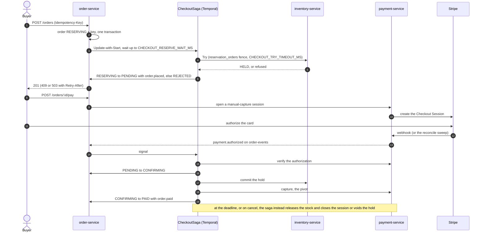

# Engineering highlights

The parts worth reading the code for: each problem, the approach taken, and the file to open. The [README](../README.md#engineering-highlights) keeps a one-line summary of the strongest ones; the decisions behind them, with their rejected alternatives and revisit triggers, are in [system-architecture.md](./system-architecture.md). Paths under `apps/api/src/` are the api's; every other service is named in its path.

## Concurrency and consistency

| Problem | Approach | Where |
| --- | --- | --- |
| **Oversell under contention** | Two interchangeable strategies behind one port, picked by the inventory-service's `INVENTORY_LOCK_STRATEGY`: pessimistic `SELECT … FOR UPDATE`, or a version CAS with bounded retry (`INVENTORY_OPTIMISTIC_MAX_RETRIES`, default 3). Both run inside the participant's Try, a local transaction fenced per order by a `reservation_orders` header, so a duplicate Try holds once and a Try arriving after its release holds nothing, which is what makes a Try that timed out on the wire safe to give up on. Three `CHECK` constraints (`ck_stock_on_hand_nonneg`, `ck_stock_reserved_nonneg`, `ck_stock_no_oversell`) make the database the final authority | `apps/inventory-service/src/modules/inventory/application/inventory-participant.service.ts`, `…/infrastructure/stock.repository.ts` |
| **Checkout across databases** | The order and its stock live in different databases, so checkout is ordered steps, not one transaction. The order-service inserts the order `RESERVING` with its price-snapshot lines and claims the idempotency key under a per-buyer advisory lock, then starts the saga, whose Try holds the stock in the inventory-service's own transaction; the saga then moves the order to `PENDING` and appends `order.placed`, and only then is the key frozen on the `201`. A shortfall leaves the order `REJECTED`, answered `409` and hidden from the buyer, with no key blocking the retry. A Try past its budget answers `503` with `Retry-After`, and its late hold is fenced off | `apps/order-service/src/modules/order/application/use-cases/checkout-order.use-case.ts`, `…/infrastructure/drizzle-order.repository.ts` |
| **Exactly-once settlement** | One workflow per order, the only writer of its status. Each move is a pure transition that lands through `applyOrderChange`: the order row lock plus a from-status guard, so a retried activity is a no-op. No distributed lock. Capture is the pivot: it runs once, idempotently, after stock has committed, and everything before it is undone by release and void | `apps/order-service/src/modules/order/domain/checkout-saga.ts`, `…/infrastructure/drizzle-order.repository.ts` |
| **Duplicate checkout requests** | Two layers: a per-`(scope, key)` idempotency entry gate that replays the first response body and status, and a `UNIQUE (user_id, idempotency_key)` index on `orders` as the backstop. A key reused with a different request body is `422`, not a silent replay. A key left `IN_PROGRESS` by a crashed request is reclaimable after a 30 s lease; a reclaim racing a request that is still alive is safe, because checkout also takes a per-user advisory lock and the unique index still decides | `apps/order-service/src/modules/order/interface/idempotency.interceptor.ts`, `…/application/ports/idempotency-store.port.ts` |
| **Refresh-token theft** | Rotation runs in one `FOR UPDATE` transaction. Presenting a token that was already replaced or revoked revokes the **entire family**, not just that token — and revocation is checked before expiry, so a retired token still reads as reuse rather than as an expiry. Only a replay that finds live tokens counts as theft and bumps the session epoch, so an old token replayed again cannot keep logging the owner out. A replay within `REFRESH_REUSE_GRACE` (default 20 s) of the token's rotation, as two tabs or a client retry send, answers `401` and revokes nothing: it gets no tokens, and only the successor stays valid. Rotation, the login insert, logout, logout-all, session revoke and password change or reset all take one exclusive per-user advisory lock, so a revoke never misses a successor inserted by a rotation already in flight, and a login or password change that checked a password a concurrent reset replaced stores nothing | `apps/user-service/src/modules/user/infrastructure/drizzle-refresh-token.repository.ts` |

## Distributed systems

Checkout is a saga orchestrated by the order-service as a Temporal workflow (`CheckoutSaga`, id `checkout-<orderId>`), with stock and payment as its two TCC participants. Capture under Stripe manual capture is the pivot: before it, everything is undone by a release and a void; after it, the order is `PAID`. The decision, its rejected alternatives and when to revisit it are in [system-architecture.md](./system-architecture.md#checkout-saga-orchestration-on-temporal-tcc-on-stock-and-payment); the order's states are drawn in the [order-service README](../apps/order-service/README.md#order-lifecycle).



### Checkout anomalies

| Anomaly | Countermeasure | Where |
| --- | --- | --- |
| **A Try times out on the wire, then lands** | The Try is one attempt, aborted with its activity. The release that compensates it writes the `reservation_orders` fence first, so the late Try is refused (`FENCED`, answered `CONFLICT`) instead of holding stock nobody will release | `apps/inventory-service/src/modules/inventory/application/inventory-participant.service.ts` |
| **A command is delivered twice, or a worker dies mid-activity** | Commit, release, restock, capture and cancel are idempotent per order, and their activities retry until they land. Temporal replays the workflow after a crash and the order write is guarded by its from-status under the row lock | `apps/order-service/src/modules/order/infrastructure/temporal/workflows/checkout-saga.workflow.ts` |
| **A cancel races the card authorization** | Both are saga inputs handled in order by one workflow, so the order ends one way. A cancel is refused with `409` once payment is being taken | `apps/order-service/test/integration/checkout-saga-cancel.e2e-spec.ts` |
| **The webhook never arrives, or arrives five times** | A polling reconcile sweep asks Stripe about payments whose event never came; `webhook_events` deduplicates on `(provider, event_id)` | `apps/payment-service/src/modules/payment/application/use-cases/reconcile-tcc-payments.use-case.ts` |
| **The card is authorized after the order closed** | A `lateAuthorization` run voids it; an order the database does not hold counts as not `PAID`, so such a run never captures | `apps/order-service/src/modules/order/application/use-cases/forward-payment-authorization.use-case.ts` |
| **Stripe fails or loses a capture answer** | The idempotency key is `capture:{paymentId}:{gen}`, and `gen` moves only after a 5xx that Stripe did not apply, because Stripe replays a stored 5xx for its key | `apps/payment-service/src/modules/payment/infrastructure/schema/payment.schema.ts` |
| **Cleared money on a session no checkout owns** (a card authorized late is voided, never charged, so this is the one refund left) | Logged and counted as a refund owed (`payment_refund_owed_total`); no alert fires on it and refunds are manual ([RUNBOOK → A refund is owed](../RUNBOOK.md#a-refund-is-owed)) | `apps/payment-service/src/modules/payment` |
| **Temporal is down** | `POST /orders` and cancel answer `503` with `Retry-After` and hold no stock; sagas already running converge when it returns. A `RESERVING` order whose start never reached Temporal is handed back by the reaper | `apps/order-service/src/modules/order/application/use-cases/reap-reserving-orders.use-case.ts` |
| **A settled order disagrees with a participant** | An invariant checker compares each settled order with its stock and payment every minute and reports by kind; the system test asserts the same invariants after each injected fault | `apps/order-service/src/modules/order/application/use-cases/run-checkout-invariants.use-case.ts` |

### Messaging and event delivery

| Problem | Approach | Where |
| --- | --- | --- |
| **The dual-write problem** | Events are rows written by the same transaction as the change they describe. A relay polls `published_at IS NULL` with `FOR UPDATE SKIP LOCKED`, publishes to BullMQ and marks the row published in one transaction — at-least-once, safe on every replica, no leader election. The service that writes the row owns the relay: the api's, the payment-service's and the order-service's each read their own outbox, and the queue each event goes to comes from the service's route table | `packages/messaging/src/outbox/outbox-relay.ts`, `apps/api/src/shared/messaging/event-routes.ts`, `apps/order-service/src/shared/messaging/order-events.routes.ts` |
| **At-least-once → exactly-once** | The consumer claims `message_id = outbox.id` in an `inbox` table (`UNIQUE (consumer, message_id)`) and applies the handler's effect **in that same transaction** (anything slow, such as a call to another service, is prepared before it opens). A redelivery loses the claim and does nothing; a handler that throws takes its claim down with it, so the redelivery does the work | `packages/messaging/src/queue/domain-event.processor.ts` |
| **Sweeping the inbox safely** | Inbox claims are swept on a schedule (`RETENTION_INBOX_DAYS`, default 30d), and the app **refuses to boot** if that retention is shorter than the queue's failed-job horizon — deleting a claim while its message can still be redelivered would apply the effect twice | `packages/messaging/src/inbox/sweep-inbox.ts` |
| **Poison messages** | BullMQ retries with backoff to a bounded attempt budget (`QUEUE_CONSUMER_ATTEMPTS`, default 8 including the first delivery; `order.paid`, which waits on the user-service, gets 15 with a capped backoff, as does `payment.authorized`, which signals the checkout saga and so must outlive a Temporal outage, and `catalog.*`, which waits on the search engine), then routes to the dead-letter queue of the queue it rode: `order-events-dlq` or `api-events-dlq`. Each queue has one consumer service: the order-service for `order-events`, the api for `api-events`, so a burst of catalog events never waits behind order and payment work. `pnpm queue:replay-dlq:order --queue order-events` and `pnpm queue:replay-dlq --queue api-events` interrogate the inbox before re-publishing: a job whose effect already landed is reported `skipped`, and `--force` cannot override that — it only admits a job old enough that its claim may have been swept. Dry run is the default, and `--limit` counts the jobs replayed (or previewed), reading past the ones it skips | `packages/messaging/src/queue/dead-letter.replay.ts`, `packages/internal-contracts/src/queues/order-events.ts`, `apps/order-service/src/shared/messaging/order-events.routes.ts` |
| **Search index consistency** | No transaction reaches the engine, so the index follows Postgres through the outbox. Every catalog write bumps `products.search_version` and appends its event in the same transaction; the worker re-reads the product and writes it with `version_type: external`, so the engine refuses a stale, repeated or reordered delivery. An archived product stays as a versioned tombstone, so a late write cannot bring it back. A rebuild fills a fresh index behind a second alias and swaps atomically ([decision record](./system-architecture.md#search-index-consistency)) | `apps/api/src/modules/product/application/catalog/services/product-search-sync.service.ts`, `…/infrastructure/catalog/search/elasticsearch-catalog-search.adapter.ts` |
| **Payment saga convergence** | In the payment-service, two paths record a card hold: the HMAC-verified webhook and the reconcile sweep. Either writes `payment.authorized` once per order to the payment-service's own outbox, whose relay puts it on `order-events`; the order-service's consumer signals the order's workflow, which verifies the authorization with the payment-service before it commits stock. The workflow's own deadline timer expires an order nothing paid, releasing the stock and closing the session, so no sweep over orders is needed | `apps/payment-service/src/messaging/event-routes.ts`, `apps/order-service/src/modules/order/domain/checkout-saga.ts` |
| **A TCC participant across the network** | The saga's Try is one HTTP attempt inside its budget (`CHECKOUT_TRY_TIMEOUT_MS`), aborted with the activity: a lost answer is a `503`, and the release that compensates it fences the late hold. A breaker counts only the service's own faults, never a `409`, a `4xx` or a `503` coded `LOCK_BUDGET_EXHAUSTED`, so neither a sold-out SKU nor a contended one can open it. The payment-service has the same shape: `/pay` makes one attempt and answers `502` when the service fails, and its breaker counts only a `5xx` or no answer. Each internal callee admits each caller by a token of its own, and an allowlist per route says which caller may call it | `apps/order-service/src/modules/order/infrastructure/order-inventory-participant.http-adapter.ts`, `…/order-payment-participant.http-adapter.ts`, `packages/platform/src/internal-api/caller-token.guard.ts` |
| **Trace continuity across the async hop** | The outbox writer captures the W3C `traceparent` at insert, the relay carries it onto the job, and the consumer resumes it, so one trace runs from HTTP request through outbox insert, relay publish and consumer handler. Temporal's OpenTelemetry interceptors carry it across the saga: the client call sends it in a workflow header, the sandbox spans the run, the update and the signal handlers and every activity it schedules, and the activity's own call to the inventory- or payment-service continues it. `POST /orders` and the Try it runs are one trace; a consumed `payment.authorized` and the verify, commit and capture it sets off are another, the event's. Workflow spans leave the sandbox through a sink into the preload's span processor | `apps/order-service/src/modules/order/infrastructure/temporal/workflow-tracing.ts`, `packages/messaging/src/outbox/drizzle-outbox.writer.ts`, `packages/messaging/src/queue/domain-event.processor.ts`, `apps/order-service/test/integration/checkout-saga-trace.e2e-spec.ts` |

## Performance and caching

| Problem | Approach | Where |
| --- | --- | --- |
| **Thundering herd on cache expiry** | Reads go through stale-while-revalidate behind a Redis **single-flight rebuild lock** with a lease and jitter: one request rebuilds, everyone else is served the stale value. `cache_rebuild_duration_seconds` measures the rebuild | `apps/api/src/shared/cache/swr-cache.service.ts`, `apps/api/src/shared/cache/single-flight.lock.ts` |
| **Thundering herd without Redis** | When Redis cannot answer (the generation counter, the read, the lock) or a waiter outlasts its lock budget, concurrent lookups of one key in a process share one Postgres read, so an outage multiplies source reads by the replica count, not by the traffic | `apps/api/src/shared/cache/swr-cache.service.ts` (`readThroughShared`) |
| **Overload into one event loop** | The api admits at most `HTTP_MAX_IN_FLIGHT` (48) requests at once and answers the rest `503` with `Retry-After` before any Nest middleware runs; `/health*` and `/metrics` are never refused. Past a few dozen in flight a Node process only queues, until Redis and pool timeouts turn an overload into errors for everyone. Refusals count in `http_requests_shed_total`, not in `http_requests_total` | `packages/platform/src/resilience/load-shedding.middleware.ts` |
| **Connection storms at the gateway** | Each upstream gets at most `UPSTREAM_MAX_CONNS` (64) connections, 64 kept idle. Unbounded, every request past the idle pool dialled a new connection: in each local overload run the gateway ran out of ephemeral ports or hit its memory limit, while capped runs at the same load answered without a `502` | `apps/gateway/Caddyfile` |
| **Catalog-wide invalidation** | A generation counter, not key enumeration: bumping one Redis integer retires every catalog key at once, in O(1). Staleness after a *missed* invalidation is bounded by `CATALOG_CACHE_TTL_SEC` **plus** the shared stale window and jitter (≈100s at defaults) | `apps/api/src/modules/product/infrastructure/catalog/catalog-cache.keys.ts`, `apps/api/src/modules/product/infrastructure/catalog/caching-catalog-admin.repository.ts` |
| **Cache poisoning across deploys** | The cache codec re-validates every field on read, so a shape change between deploys degrades to a cache refill instead of a 500 | `apps/api/src/modules/product/infrastructure/catalog/product-cache.codec.ts` |
| **Presigned URLs vs cached documents** | Catalog stores **asset ids, never URLs**. A presigned URL outlives its cache entry by minutes and the entry by hours, so URLs are resolved *after* the cache read — one batched call per response page. An id whose asset has since gone is dropped rather than rendered as a broken image | `apps/api/src/modules/product/application/catalog/use-cases/get-product-detail.use-case.ts` |
| **Unbounded cache keys** | Every query parameter is part of the cache-key fingerprint, so each is bounded at the DTO edge: `page ≤ 10000`, `pageSize ≤ 100`, `categorySlug` must match the slug pattern. An unbounded field would be an unbounded number of cache keys as well as an unbounded query | `apps/api/src/modules/product/interface/catalog/dto/list-products-query.dto.ts` |
| **Deep pagination cost** | Count and page are read inside one repeatable-read read-only snapshot with a tie-broken sort, so the total and the rows cannot disagree | `apps/api/src/modules/product/infrastructure/catalog/drizzle-product.repository.ts` |

## Measured performance

Numbers below are from k6 against the **live Railway deployment**, not a local run and not a projection. Reproduce with:

```bash
BASE_URL=https://jcool-ecommerce.up.railway.app PROFILE=steady pnpm load:public-read
```

**Read this before reading the numbers.** They are client-side timings taken from a single machine in Vietnam against a deployment in another region, so **the round trip dominates every figure**. The measured TCP connect time is **≈90 ms**, and `GET /health/live` — which touches no database, no cache, and no authentication — still costs **≈305 ms**. That ~305 ms is the floor of the path, not the cost of the application. What the application costs is the *gap above that floor*, and the whole point of the table is that there barely is one.

### Steady read profile — 1.5 req/s, 4 min, 361 requests

Offered under the app-wide IP throttle so the app is measured rather than the rate limiter. **0 × `429`, 0 × `5xx`, 0 dropped iterations.**

| Route | Work it does | min | med | p90 | p95 |
| --- | --- | ---: | ---: | ---: | ---: |
| `GET /health/live` | none — the path floor | 290.5 ms | 310.5 ms | 619.3 ms | 700.2 ms |
| `GET /products` | cached list, page 1 | 296.1 ms | 311.9 ms | 422.5 ms | 622.5 ms |
| `GET /products/:slug` | cached detail | 297.1 ms | 310.4 ms | 449.9 ms | 639.2 ms |

**A cached catalog read is within ~1.5 ms of a no-op liveness probe at the median**, and within ~7 ms at the minimum. The SWR cache and the generation-counter invalidation are doing what [Performance and caching](#performance-and-caching) claims: at steady state a product read does not reach Postgres, and the residual cost is too small to separate from network jitter.

### Load — 50 req/s, 30 s, 1,500 requests

**0 × `429`, 0 × `5xx`, 0 dropped iterations.** A **32×** increase in offered load left every median unchanged within ~5 ms — all three, in fact, came in marginally *faster* than at 1.5 req/s, which is the signature of a system nowhere near its knee:

| Route | min | med | p90 | p95 |
| --- | ---: | ---: | ---: | ---: |
| `GET /health/live` | 291.2 ms | 305.9 ms | 618.0 ms | 725.2 ms |
| `GET /products` | 291.1 ms | 308.4 ms | 588.7 ms | 737.6 ms |
| `GET /products/:slug` | 292.4 ms | 307.7 ms | 584.2 ms | 646.3 ms |

### Saturation — 150 req/s offered, 30 s

Achieved **≈81 req/s**; the remaining **28 % answered `429`** and one request returned `5xx`. Latency on the requests that *were* served stayed flat (median 306 ms, p95 640 ms) — the deployment sheds load rather than degrading under it, which is the correct failure mode.

Those `429`s are also where the `TRUST_PROXY` gap in [Known limits](./system-architecture.md#known-limits) showed itself: k6 reuses connections, so many requests share one proxy peer address and *do* trip the 100/60 s tier — while a client opening a fresh connection per request never does. Same offered load, opposite outcome, decided by connection reuse rather than by who is calling.

**The ceiling here is not attributed.** It could be the single Railway container, the platform edge, the client, or the WAN path, and a single-client run from one continent away cannot tell them apart. Calling ~81 req/s "the application's capacity" would be dishonest. The experiments that *can* attribute a bottleneck run against the local stack, where Prometheus is scrapable and the `route:http_request_duration_seconds:p99` recording rules are authoritative — see [`test/load/`](../test/load) and `load:breakpoint` / `load:cache-stampede` / `load:sku-contention`.

> At the time of this run `/metrics` answered `404` on the deployment (no `METRICS_TOKEN` was configured), so no server-side latency, cache-hit or pool figures were available to corroborate these client-side numbers. Prometheus on Railway now scrapes it with the api's token.

## Security

| Problem | Approach | Where |
| --- | --- | --- |
| **Immediate JWT revocation** | Stateless ES256 access tokens, signed by the user-service and checked against its JWKS, carry `{sub, role, jti, epoch}` and are re-checked per request against a Redis `jti` denylist (one token) and a per-user epoch (every token issued before a logout-all or password change). The user-service is the only writer of those keys; the api only reads them | `packages/auth-verifier/src/access-token.verifier.ts` |
| **Token delivery and CSRF** | The access token goes in the JSON body (Bearer is CSRF-immune). The refresh token goes **only** in an `httpOnly; SameSite=Strict; Path=/auth` cookie, paired with a signed double-submit CSRF cookie enforced on the two routes that consume it (refresh, logout). Login and refresh also return the CSRF token as `csrfToken` in the body, since a page outside `/auth` or on another origin cannot read the cookie, and the client sends it back as `x-csrf-token`. Logout is authorised by the refresh cookie and that pair alone, so it still works after the access token expired. Both live in the user-service; the api takes Bearer only | `apps/user-service/src/modules/user/interface/security/csrf.guard.ts` |
| **Brute force** | Three Redis-backed tiers with different keys: `default` by IP (100/60s app-wide floor; tightened to 20/60s with a 5-min block on the routes that take an email — login, register, resend-verification, forgot-password — and to 30/60s on the other token-consuming auth routes), `account` by IP + SHA-256(email) on those email routes (5/15min, 15min block), `user` by authenticated id on checkout, payment-session creation and cancel (10/60s) — the tier an attacker cannot outrun by rotating IPs | `packages/platform/src/throttler/throttler.constants.ts` |
| **User enumeration** | `forgot-password` and `resend-verification` always answer `202`. Login runs a real argon2 verify against a cached dummy hash on the unknown-email branch, so the timing of "no such user" matches "wrong password" | `apps/user-service/src/modules/user/application/use-cases/login-user.use-case.ts` |
| **Webhook authenticity** | HMAC-SHA256 over the **raw request bytes** (`rawBody: true` — the JSON parser would re-serialize and break the signature), constant-time compare, plus a `±PAYMENT_WEBHOOK_TOLERANCE_SEC` replay window. Never throttled, so a burst of legitimate gateway retries is never rate-limited away. It is the payment-service that verifies it, behind the gateway's `/webhooks/payment` route | `apps/payment-service/src/modules/payment/infrastructure/gateway/hmac-signature.ts` |
| **Metrics endpoint disclosure** | A wrong or missing `METRICS_TOKEN` returns a plain `404`, never `401` — a `401` confirms the endpoint exists to anyone probing. (With no token configured at all, `/metrics` is open in development and `404` in production.) | `packages/platform/src/observability/metrics/metrics.guard.ts` |

## Data modelling

| Problem | Approach | Where |
| --- | --- | --- |
| **One id layout everywhere** | Every id in every service is a signed 63-bit integer in a Postgres `bigint`, laid out `45 ts_ms │ 8 node │ 10 seq` over an epoch of 2026-01-01, good until year 3140. The id carries no routing information: a future shard split would need a lookup or directory, not a bit field, and that is a deliberate trade for the timestamp, node and sequence room the freed bits bought ([decision record](./system-architecture.md#63-bit-snowflake-layout-45-ts_ms--8-node--10-seq)) | `packages/id-codec/src/snowflake.codec.ts` |
| **An integer id that travels as a string** | 63 bits outruns the 53 a JSON number carries exactly, from 2027-02-02 on, so an id crosses the wire as a decimal string and nothing applies `Number()` to one. Drizzle's two `bigint` modes are both wrong here — `number` truncates silently, `bigint` makes `JSON.stringify` throw — so the column is a `customType` whose TypeScript type is `string`. node-postgres already hands back `int8` as a string, so both directions are identity and every `userId: string` signature in the repo stayed as it was | `packages/platform/src/database/snowflake-id.column.ts` |
| **The layout is pinned** | The epoch and field widths are permanent. The user-service's database pins the layout version it was built under and refuses a later boot under a different one, so a layout change is a reset, not a migration ([RUNBOOK → The id layout is permanent](../RUNBOOK.md#the-id-layout-is-permanent)) | `apps/user-service/src/modules/user/infrastructure/identity-layout-pin.verifier.ts` |
| **Money** | Integer minor units (VND đồng, USD cents) in a `Money` value object — never a float. Cross-currency operations throw rather than coerce. The order total is computed once from the lines and then persisted, never recomputed against a live price | `packages/kernel/src/money.vo.ts` |
| **Media lifecycle as stock reservation** | An upload commits to something before knowing whether the caller will finish, so it is modelled like a stock hold: `PENDING → READY → ATTACHED → DETACHED`, plus `SWEEPING` as a terminal claim. `expires_at` is `NULL` in exactly one state (`ATTACHED`) — an asset no sweep can select is exactly what that state needs and exactly the leak every other state must not have | `apps/api/src/modules/media/domain/asset-state-machine.ts` |
| **Deleting bytes safely** | The sweep commits its `SWEEPING` claim **first**, then deletes the object, then the row. A crash mid-way leaves an orphan row whose object is gone — re-scannable, and deleting an absent object is a no-op. The other order leaves bytes nobody has a pointer to: unfindable and paid for indefinitely | `apps/api/src/modules/media/application/use-cases/sweep-abandoned-assets.use-case.ts` |
| **Deadlock avoidance** | Attaching an image claims the asset and writes the link row in one transaction, always taking `product_images` before `media_assets`, so two concurrent edits of the same asset cannot deadlock | `apps/api/src/modules/product/infrastructure/catalog/drizzle-catalog-admin.repository.ts` |

## Observability

Three pillars plus error tracking, wired **around** the Clean Architecture core — `domain` and `application` import none of it, and `arch:check` fails the build if they start to.

- **Logs** — structured JSON via `nestjs-pino`. Every line of a request carries the same `requestId` (`nestjs-cls` + `AsyncLocalStorage`), echoed as `x-request-id`, so a support ticket quoting a header reaches the exact lines that served it. Always to stdout; with `LOKI_URL` set, every line is also pushed to Loki through a pino worker, so a slow or dead Loki never blocks a request ([logging conventions](./code-standards.md#where-the-lines-go)). Email is deliberately *not* in the shared redaction list — the auth audit trail is supposed to record it, and the Sentry sink strips it separately.
- **Metrics** — `GET /metrics`, token-guarded. Default process metrics, RED HTTP metrics with `route` as a path template rather than a raw id (cardinality is a cost that only shows up later, in a Prometheus that has stopped being queryable), and business counters. Metric emission can never throw into a business flow: a telemetry failure must not become an order failure.
- **Traces** — OpenTelemetry, off by default. The SDK loads via `node --import ./dist/instrumentation.js` *before* Nest boots, so auto-instrumentation patches `http`/`express`/`pg`/`ioredis` before those modules are required. In the order-service a trace also crosses the checkout saga's Temporal workflow and its activities; with the SDK off the interceptors still run, but their spans go nowhere.
- **Errors** — Sentry, off unless `SENTRY_DSN` is set; it reuses the app's own OTel SDK (`skipOpenTelemetrySetup`) rather than starting a second one, which would duplicate every span.

Alerting ships as code: seven Prometheus rule files (multi-window burn-rate SLOs, resilience, identity clock, log pipeline, checkout saga, queue consumers, scrape targets) with matching `promtool` unit tests that pin both **firing and clearing** behaviour, run in CI.

**The checkout saga** reports through the order-service's own `/metrics`, since Prometheus never scrapes Temporal. Activities count each step and compensation (`saga_step_total`, `saga_compensation_total`); at scrape time the order-service reads from Temporal the open sagas per step, the overdue ones, the abnormal closes and the task queue's pollers and backlog, all within 2s, and reports `checkout_saga_engine_up` 0 with the rest withdrawn when it cannot. An invariant checker compares each settled order with its stock and payment participants every minute and reports what disagrees by kind. Alongside it, the BullMQ queue gauges (`messaging_queue_jobs`, `messaging_queue_oldest_waiting_seconds`, one series per queue) cover `order-events`, which carries `payment.authorized` to the saga, and `api-events`; `payment_authorized_uncaptured_oldest_seconds`, the money held on cards, comes from the payment-service. The order-service's readiness includes Temporal and the api's and the gateway's do not, so a Temporal outage stops checkout and the order-service's deploy without taking catalog or cart out of rotation; `CheckoutSagaEngineDown` and `CheckoutSagaWorkerStalled` are the Temporal signals, and `OrderScrapeDown` covers the case where every other checkout alert is blind. The api, the inventory-service and the payment-service are scraped as their own jobs: `ApiScrapeDown`, `InventoryScrapeDown` and `PaymentScrapeDown` page when one goes dark, `CircuitBreakerOpen{breaker="inventory-service"}` and `CircuitBreakerOpen{breaker="payment-service"}` when the order-service stops calling it, and the SLO recording rules count only the api's public routes. Each alert has its section in [RUNBOOK → The checkout saga](../RUNBOOK.md#its-alerts).

**On Railway**, `.railway/railway.ts` deploys Prometheus, Loki and Grafana next to the services. Prometheus scrapes the `/metrics` of the api, the order-service, the inventory-service and the payment-service and Loki's own push metrics; every Node service pushes its logs to Loki, whose chunks live in a Railway bucket with a 30-day retention. Grafana is the only public part of the stack and requires a login. No trace backend runs there, so Grafana links a `traceId` to that trace's log lines across services instead ([RUNBOOK → Logs in Loki](../RUNBOOK.md#logs-in-loki)). The local stack, with Jaeger for traces, is in [local-development.md](./local-development.md#local-observability-stack).

<picture>
  <source media="(prefers-color-scheme: dark)" srcset="./diagrams/observability-dark.svg">
  
</picture>

## Testing on real infrastructure

The integration tier wires each app to real infrastructure, with no database mocking. A single `globalSetup` boots **Postgres + Redis** once per run, applies the committed migrations to a template database and clones one database per worker from it; the media, search and mail suites additionally boot **MinIO, Elasticsearch and Mailpit** per spec file, kept out of `globalSetup` so unrelated files never wait on containers they don't use. So the suite exercises real S3, a real search engine and a real SMTP server. Each worker gets its own Postgres database and its own Redis logical database.

Details worth stealing: the e2e app factory quarantines the developer's `.env` so a local file cannot change test behaviour; the order-service's suites run against in-memory inventory-service, payment-service, api and user-service stubs that pass the same contract cases (`@jcool/internal-contracts/testing`) as the real services and can fail, hang or answer busy rows on any route on cue, beside a real Temporal dev server; each spec file gets its own BullMQ keyspace; webhook fixtures are signed by the **production** signer, so verification runs unmocked against a test secret; and Redis outages are scripted rather than mocked.

The system tier runs production images on a Docker network. For the `id-service` and the `gateway`, it checks three replicas minting 100k ids behind the gateway with no id or `(ts, node, seq)` repeated, and a caller that never sees an error while a replica is killed, frozen with `SIGSTOP`, or all three are replaced. For the api behind the gateway, it checks that each route returns the same status and headers as calling the api directly. It also checks that the throttle keys on the address the edge reported, that no spelling of `/internal` gets through, and that no token or credential reaches the access log.

The order-service's system test is the whole checkout in containers: Postgres, Redis, Temporal, etcd, the gateway and every service as its production image, Toxiproxy on the order-service's calls to the stock and payment services, and a stateful fake Stripe with idempotency keys, signed webhooks and injectable faults. It kills or stops containers mid-saga, cuts and delays the internal calls, makes Stripe hang or fail, redelivers the webhook, and after each scenario checks the invariants across the three databases, the fake Stripe and Temporal's visibility. How to run the tiers: [local-development.md → Tests](./local-development.md#tests).
