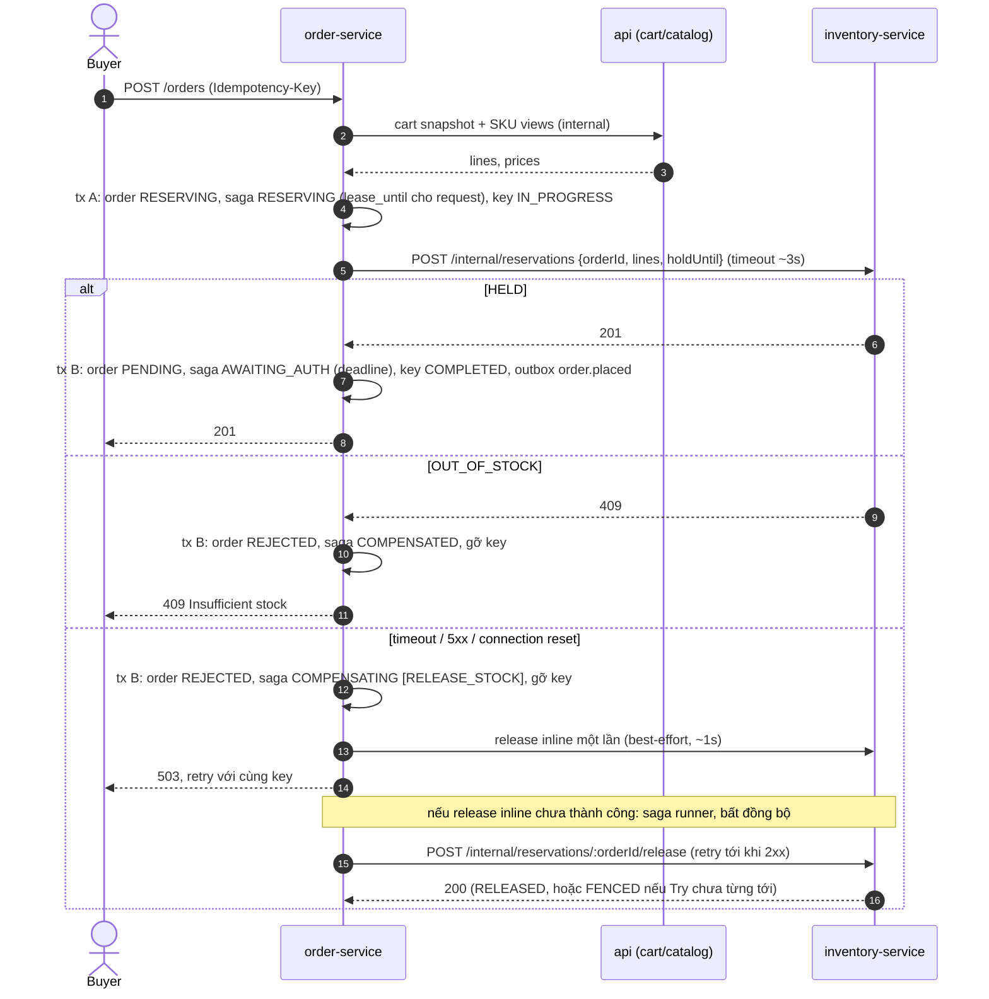
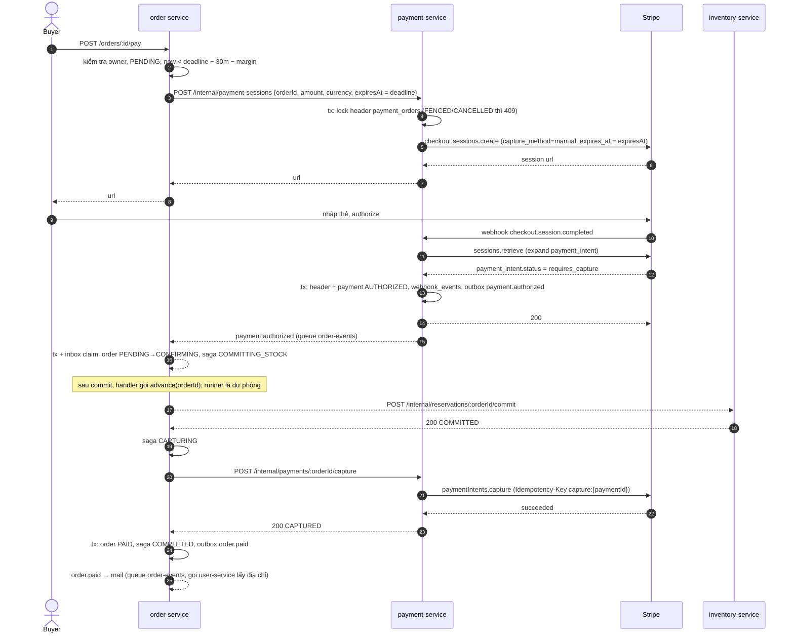
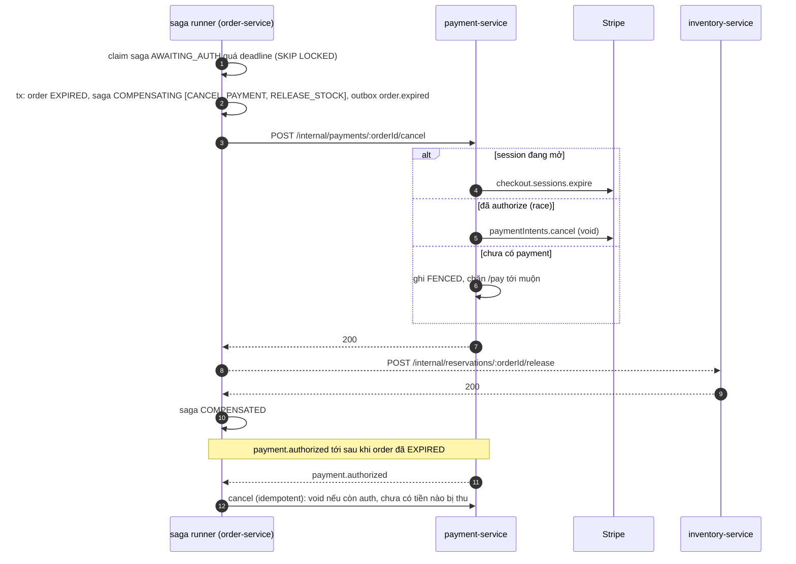
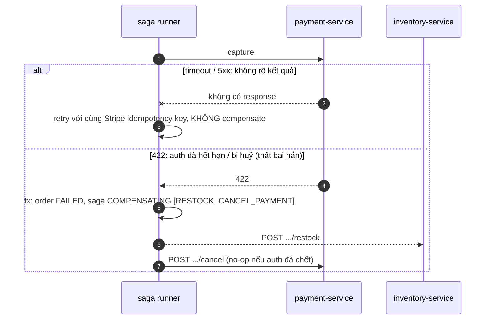

## 1. Checkout: thành công, hết hàng, Try timeout

## 2. Thanh toán: authorize, commit, capture

## 3. Hết hạn hoặc huỷ, và authorization tới muộn

## 4. Capture thất bại sau khi stock đã commit

